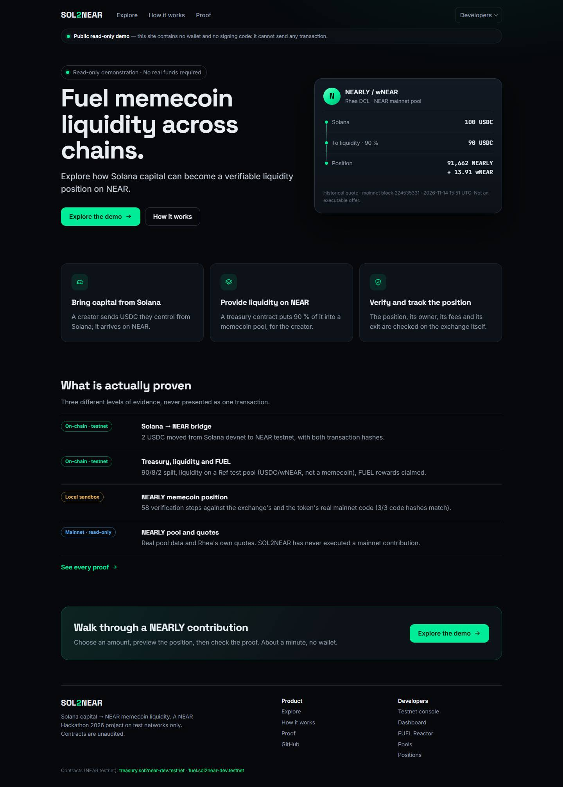

# SOL2NEAR

**Fuel memecoin liquidity across chains.** SOL2NEAR lets Solana memecoin creators route USDC they control into a
liquidity position on NEAR that anyone can verify: who holds it, what it earned, how it exits.

**Live demo → https://sol2near-demo.vercel.app** · read-only: the site has no wallet and no signing code, and cannot
send a transaction. Test networks only; test tokens have no value.

> The site currently serves commit `4c88875`, with the earlier 8-step NEARLY journey. The redesigned interface described
> below (Choose → Preview → Proof) is in this repository and goes live at the next approved deployment.



NEAR Hackathon 2026 · tracks **`memecoins`** and **`defi`** · solo project · MIT.

## What is SOL2NEAR?

Memecoin creators earn fees on Solana, but that money rarely becomes lasting, transparent liquidity elsewhere.
SOL2NEAR is a **liquidity router**, not a bridge, a launchpad or an exchange:

1. the creator sends USDC from Solana (by hand: Pump.fun / Bags creator fees are **not** captured automatically);
2. a NEAR **Treasury** contract splits it **90 % liquidity · 8 % creator reserve · 2 % community**;
3. the liquidity budget becomes a pool position held for the creator, read back from the exchange, locked, and tracked
   with its fees and its exit.

It is for creators who want to give their community verifiable liquidity, and for anyone who wants to check it.

## Live demo

Three steps, about a minute, no wallet:

| Step | What you see |
|---|---|
| **Choose** | The real NEARLY / wNEAR pool on Rhea DCL (NEAR mainnet, read-only), an amount in USDC and a price range |
| **Preview** | What the contribution becomes: 90 % to liquidity, the estimated NEARLY + wNEAR position, price impact, the main risk. A **historical quote** pinned to mainnet block 224 535 331, or a **live indicative quote** with every view read at one block. Neither is an executable offer |
| **Proof** | "Local sandbox execution verified": position created, ownership verified, fees accounted for, withdrawal tested — then the 58 technical steps on demand |

**Proof** (`#/proofs`) lists the testnet transactions in a simple and a technical view. Developer tools (testnet
console, Dashboard, FUEL Reactor, Pools, Positions) sit under **Developers**.

## How it works

```
Solana (USDC) ──► Cross-chain transfer ──► NEAR Treasury (90/8/2) ──► Liquidity position
 Phantom           Tidepool *               no admin method            Ref pool (testnet)
                                                                       Rhea DCL / NEARLY (local sandbox)
```
\* Tidepool is a community 1Click-compatible **sandbox, not the official NEAR Intents** service (NEAR Intents has no
testnet). A production version would target the official 1Click API.

The contracts check the proof themselves: the Treasury reads the exchange with cross-contract calls to confirm the
liquidity it holds, and FUEL re-reads the Treasury and the exchange before rewarding a position. No oracle, no backend.

## What is actually proven?

| Capability | Evidence | Where |
|---|---|---|
| Solana → NEAR bridge | **On-chain**, Solana devnet → NEAR testnet (2 USDC → 1.9948 USDC) | G7-SOL `bGUicpgy…887R`, G7-NEAR `J58H2uyu…RFqf` |
| Treasury V3, 90/8/2 split | **On-chain**, NEAR testnet, from the CLI and from the dashboard with a real wallet | C1, G6-D, G7-TREAS |
| Ref liquidity (pool #2951, USDC/wNEAR — a test pool, **not a memecoin**) | **On-chain**, NEAR testnet, shares verified against Ref | C2, C3, G6-LP |
| FUEL rewards | **On-chain**, NEAR testnet: admission, season close, one claim, second claim refused | C4–C7, G6-CLAIM |
| NEARLY position on Rhea DCL | **Local sandbox** running byte-identical mainnet code of the DCL and of the NEARLY token (58 steps) | `bash scripts/proofs/nearly-proof.sh` |
| NEARLY on mainnet | **Read-only** pool data and Rhea quotes. SOL2NEAR has never sent a mainnet transaction | `node scripts/probes/nearly-reference-sim.mjs` |

Every hash is in [docs/G8_PROOF_LEDGER.md](docs/G8_PROOF_LEDGER.md) and re-verified without keys by
`node scripts/probes/verify-testnet.mjs` and `node scripts/probes/verify-g6-g7.mjs`. The testnet path and the sandbox
path are two levels of evidence; they were never one transaction.

## Architecture

| Module | Role | Status |
|---|---|---|
| `contracts/treasury` | V3 Treasury: USDC intake, 90/8/2, Ref LP pipeline, Proof of Liquidity | deployed on testnet |
| `contracts/fuel` | FUEL: fixed-supply NEP-141 and Reactor seasons gated by Ref-verified liquidity | deployed on testnet |
| `contracts/treasury-dcl` | TreasuryDCL: Rhea DCL concentrated-liquidity positions (HotZap, fees, NFT exit) | local sandbox only |
| `contracts/treasury-v4`, `contracts/sandbox-meme` | Classic memecoin pilot and its test token | local sandbox only |
| `packages/crosschain` | Solana devnet → NEAR client (Tidepool quotes, unsigned SPL deposit, status) | used on devnet/testnet |
| `packages/near-client` | Plans from live exchange views, split rules, proof fixtures | — |
| `apps/web` | The site: product pages + developer tools; a public build without wallet code | — |
| `sandbox-tests` | near-workspaces runs against the real Ref, Rhea DCL, NEARLY and Tidepool USDC code | — |

Map of the documentation: [docs/README.md](docs/README.md).

## Quick start

Requirements: Node ≥ 22.18, pnpm 10 (`corepack enable`), Google Chrome for the browser tests, Rust stable with
`wasm32-unknown-unknown` for the contracts.

```bash
git clone https://github.com/nielslecodeur/SOL2NEAR && cd SOL2NEAR
pnpm install --frozen-lockfile
pnpm typecheck && pnpm test:ts && pnpm --filter @sol2near/web test   # near-client 64, crosschain 36, web 48
pnpm --filter @sol2near/web dev                                      # the full app, signing only in your own testnet wallets
pnpm --filter @sol2near/web build:public && pnpm check:public        # the read-only public build → "public bundle is read-only"
pnpm --filter @sol2near/web e2e:offline                              # 20 browser tests, every public endpoint blocked
pnpm check:release && pnpm check:docs                                # no key material or personal path; every doc link resolves
cargo test --workspace                                               # 34 + 31 + 47 + 3 + 41
```
On Windows, `cargo test` needs the CMake environment of [docs/ARCHITECTURE.md](docs/ARCHITECTURE.md) §7 and a short
`CARGO_TARGET_DIR`.

## Reproduce the proof

```bash
bash scripts/proofs/nearly-proof.sh      # Linux, macOS or WSL: wsl -d Ubuntu -- bash scripts/proofs/nearly-proof.sh
```
Needs Rust with `wasm32-unknown-unknown` and `cargo install cargo-near --version 0.22.0 --locked`; near-workspaces
downloads the local neard itself. The script fetches the contract **code** of `dclv2.ref-labs.near`, `wrap.near` and
the NEARLY token with read-only `view_code` calls, builds TreasuryDCL, runs the scenario in a fresh local chain
(≈ 65 s) and compares the export with the committed one:
```
test result: ok. 1 passed
PASS dcl code = mainnet 3G34Nhjmir5JPYPtijaA9iCNnHDPR7h3wfC9H77woEGo
PASS nearly_token code = mainnet 5qScjXG9uRG82Yrh36XZNZgVUYiqPtuC9ep5DvV42eGQ
PASS export identical to the committed packages/near-client/src/fixtures/nearly_dcl_sandbox_proof.json (58 steps)
```
The run rewrites the timestamps of `packages/near-client/src/fixtures/v42_dcl_sandbox_views.json`; restore it with
`git checkout`. Step-by-step guide for reviewers: [docs/JUDGE_QUICKSTART.md](docs/JUDGE_QUICKSTART.md).

## Security and limitations

- **Unaudited contracts.** Ref and Rhea contracts are upgradeable by their DAOs.
- **No SOL2NEAR Treasury on mainnet**, no mainnet bridge, no funded NEARLY position. The NEARLY position exists only in
  a local sandbox.
- **Full-access keys** are still on the testnet contract accounts `treasury.sol2near-dev.testnet` and
  `fuel.sol2near-dev.testnet`: the contracts have no owner, admin method or setter, but the developer could redeploy
  them. The rules are enforced by the code, not yet locked at the account level.
- **G8 is not completed:** one operation reconciled end to end (Solana → Treasury → LP → FUEL). Deposit #3 holds the
  bridged USDC; its LP plan (29.13 % price impact on the shallow test pool) was not authorised.
  [docs/G8_FINAL_EXECUTION.md](docs/G8_FINAL_EXECUTION.md).
- **No V3 exit demonstrated:** `withdraw_lp` exists in code but was never exercised on-chain, and V3 cannot return an
  unused LP budget.
- **The public demo is read-only.** Quotes are historical or indicative, never executable offers.
- **No yield is promised.** Pool fees vary and can be zero; a concentrated position earns nothing outside its range, and
  a memecoin can lose most of its value.
- **Fees:** no bridge, swap or protocol fee is hard-coded; costs come from real quotes (Tidepool `/v0/quote`, Ref
  `get_return`, Rhea `quote`). SOL2NEAR takes 0 %.

## Documentation

- [Judge quickstart](docs/JUDGE_QUICKSTART.md) — reproduce everything without a key, funds or a public transaction
- [Memecoin proof](docs/HACKATHON_MEMECOIN_PROOF.md) — what the NEARLY demo proves, and on which evidence
- [Architecture](docs/ARCHITECTURE.md) · [FUEL rules](docs/FUEL_REACTOR.md) · [Rhea DCL design](docs/V4_2A_DCL_FEASIBILITY.md)
- [Security / release audit](docs/G9_INDEPENDENT_AUDIT.md) · [Proof ledger](docs/G8_PROOF_LEDGER.md)
- [Interface release notes (H6)](docs/H6_UI_UX_RELEASE.md) · [Hackathon rules checklist](docs/HACKATHON_CHECKLIST.md)
- Earlier checkpoint reports: [docs/archive/](docs/archive/README.md)

## Prior work, libraries, AI assistance

- **Prior work:** none. The repository was created on 2026-11-11, inside the hackathon window.
- **Libraries:** `near-sdk` / `near-contract-standards` 5.30.1, React 18.3.1, Vite 5.4.11, NEAR Wallet Selector 10.1.4,
  `@near-js/transactions` 2.5.1, `@solana/web3.js` 1.98.4, `@solana/spl-token` 0.4.14; tools: cargo-near 0.22.0,
  near-cli-rs 0.31.1, TypeScript 5.6.3, Playwright, pnpm 10.
- **External services:** Tidepool (community testnet sandbox), Ref/Rhea testnet exchange, NEAR and Solana public RPCs,
  read-only mainnet view calls to Ref/Rhea, Rhea DCL and Nearly (token code from github.com/sam3dsol/Nearlytrade).
- **Templates:** none.
- **AI assistance:** code and documentation were written with **Claude Code (Anthropic)** under the direction of the
  author, then reviewed and tested by the author.

## License

MIT, see [LICENSE](LICENSE).
