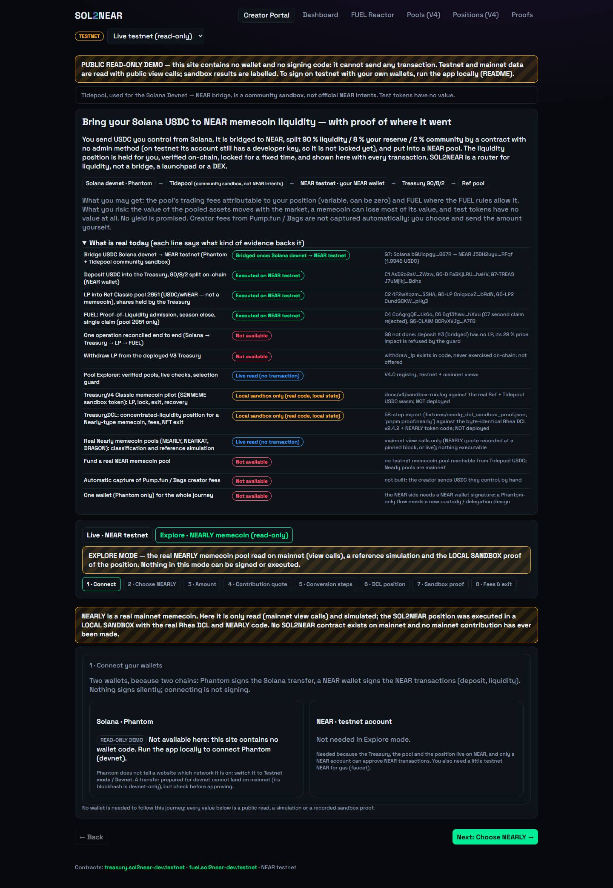
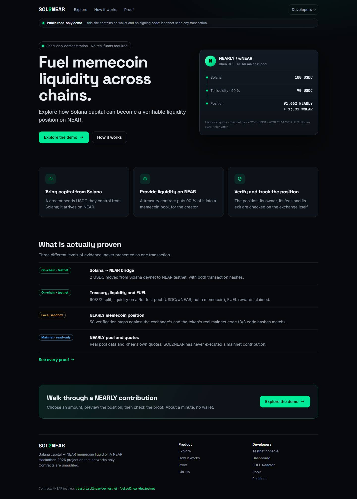
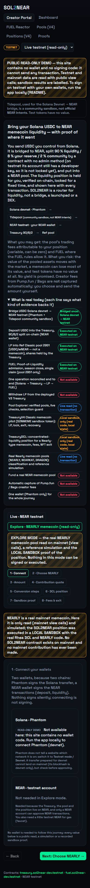
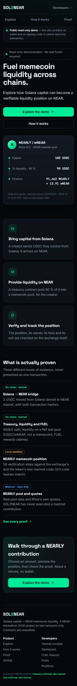

# H6 — UI/UX release, repository organisation, README

Date: 2026-11-14. Solo project. **Local commits only: nothing pushed, nothing deployed.** The public site
https://sol2near-demo.vercel.app still serves `4c88875` (H5) until a deployment is approved.
No contract, key, tokenomics or transaction was touched. No video, X post or submission was prepared.

## 1. The problem

A first-time visitor of the H5 site landed on a developer dashboard: six navigation entries, a data-source selector, two
warning banners, a 13-row evidence table and a mode switch before any content, then an 8-step journey whose labels
("Contribution quote", "DCL position") assume NEAR knowledge. They could not tell in a few seconds what SOL2NEAR does,
what to click, or what is really proven. Every fact was correct; the hierarchy was missing.

## 2. Before / after

| | Before (`4c88875`, deployed) | After (H6, local) |
|---|---|---|
| Desktop |  |  |
| Mobile 390 px |  |  |

More screens (all from the local public build, real Chrome): [Explore · Choose](h6/after-explore-choose-1440.jpg),
[Preview](h6/after-explore-preview-1440.jpg), [Proof](h6/after-explore-proof-1440.jpg), [How it works](h6/after-how-1440.jpg),
[Proof page](h6/after-proof-1440.jpg), [Choose at 768 px](h6/after-explore-choose-768.jpg), [Preview at 390 px](h6/after-explore-preview-390.jpg),
[Proof at 390 px](h6/after-explore-proof-390.jpg).

| Topic | Before | After |
|---|---|---|
| First screen | Developer header, banners, evidence table | Hero "Fuel memecoin liquidity across chains.", one status line "Read-only demonstration · No real funds required", **Explore the demo** / **How it works** |
| Main navigation | Creator Portal, Dashboard, FUEL Reactor, Pools (V4), Positions (V4), Proofs + data-source select | **Explore · How it works · Proof**; the rest under **Developers** |
| NEARLY journey | 8 tabs | 3 steps: **Choose → Preview → Proof**, the 8 stages kept inside |
| Quote labels | RECORDED / LIVE | **Historical quote** (block + UTC time) / **Live indicative quote**, both "Not an executable offer" |
| Live quote | Views unpinned (`finality: final`): ≈ 1 failure in 5 with `E101: insufficient balance` | Every view of one quote at **one** final block |
| Sandbox proof | 58 rows shown at once | Summary of 4 facts + 4 figures, then **View technical evidence** |
| Proof page | One table of 16 hashes | Simple view (4 milestones with their key links) / technical view (16 hashes, 58 steps); sections A testnet, B sandbox, C mainnet read |

## 3. Navigation

```
#/                 Home: hero, 3 concepts, what is proven, CTA
#/explore          → #/explore/choose | #/explore/preview | #/explore/proof   (step in the URL: reload and share keep it)
#/how              How it works: 4-node flow, gains / risks, evidence levels, full feature status, developer links
#/proofs           Proof: simple / technical view
Developers menu    #/console (the former Creator Portal testnet journey; #/portal also works), #/dashboard, #/vault/<id>,
                   #/reactor, #/pools, #/positions, GitHub
```
Every historical route still opens. A browser wallet that redirects back with `?transactionHashes=` or `?errorCode=` and
no hash lands on `#/console`, where the NEAR panel records the result (it used to land on the portal, which held that
panel). The developer pages keep the testnet badge, the data-source selector, the Tidepool notice (community sandbox,
not NEAR Intents) and the watch form; the product pages do not show them.

## 4. What changed, file by file

| File | Change |
|---|---|
| `apps/web/src/home/Home.tsx` (new) | Home and How it works. The hero card uses the historical quote fixture (block 224 535 331), labelled |
| `apps/web/src/portal/NearlyJourney.tsx` | 3-step Explore. Choose: pool tiles, amount with quick amounts, range as three cards, *Advanced details* (identifiers, live re-read, checks). Preview: quote status, 4 summary figures, 90/8/2 bar, main risk, *Advanced details* (split table, quote table, conversion, position), disabled *Execute on mainnet — not available*. Proof: sandbox summary + technical view |
| `apps/web/src/proofs/SandboxEvidence.tsx` (new) | `sandboxFacts()` computes each simple-view claim from the committed export: position created (F1 success, liquidity > 0), ownership (DCL owner and NFT owner = TreasuryDCL), fees (G3 claim = G1 unclaimed, > 0), withdrawal (H3 NFT owner ≠ Treasury, recovered status `PositionWithdrawn`), step count, matching code hashes, refusals. A claim the export does not support is shown with a cross and "not shown by the export". Technical view = the former step 7 + step 8 |
| `apps/web/src/proofs/Proofs.tsx` | Simple / technical views, sections A / B / C, documentation list |
| `apps/web/src/App.tsx` | Routes, header, Developers menu (closes on navigation), slim read-only status bar, skip link, footer, page titles |
| `apps/web/src/portal/CreatorPortal.tsx` | Becomes the testnet console (live mode only); its Explore mode moved to `#/explore` |
| `apps/web/src/v4/Dcl.tsx`, `apps/web/src/near/rpc.ts` | `view(…, blockId)`, `finalBlock()`, `finalMainnetBlock()`; `readLive` and `simulateDcl` take the block. The Pools page estimator is unchanged (unpinned) |
| `apps/web/src/ui/theme.css`, `ui/product.css`, `ui/icons.tsx` (new), `styles.css`, `main.tsx`, `index.html` | Design tokens (dark, one green accent), Inter for text, Space Grotesk for titles, JetBrains Mono for numbers, one icon set, a single entrance animation (none with reduced motion), focus rings. `styles.css` lost only its global header / nav / footer rules |
| `apps/web/e2e/app.spec.ts` | Adapted to the new screens (see §6); no security assertion removed |
| `scripts/check-public-bundle.mjs` | Looks for the new banner (`read-only-banner` test id + "Public read-only demo" + "cannot send any transaction") instead of the old wording |

## 5. Repository organisation

- 13 historical reports moved with `git mv` to [`docs/archive/`](archive/README.md): `CHECKPOINT.md` (root, now
  `CHECKPOINT_A1.md`), `CHECKPOINT_A2`, `G2_READINESS`, `G4_NEAR_WALLET`, `G5_BROWSER_VALIDATION`, V4.0 / V4.1B / V4.2A /
  V4.3A execution logs, `G9_1_PUBLIC_DEMO_READINESS`, `RELEASE_READINESS`, `FINAL_RELEASE_AUDIT`, the team workflow.
  Content unchanged except relative links. `V4_1_EXECUTION.md` stays because contract comments point to it.
- Every reference rewritten: relative links (re-relativised from each file's new place) and repo-root paths in text,
  in 19 files, `CLAUDE.md` included.
- [`docs/README.md`](README.md): map by audience and kind (reviewer, product, architecture and contracts, tests and
  sandboxes, on-chain / sandbox / mainnet-read proofs, archive).
- `scripts/check-doc-links.mjs` → `pnpm check:docs`: every relative Markdown link and every quoted `docs/…md` path must
  exist (147 checked, 0 broken). Before the move it found one pre-existing dangling path (a planned doc, allow-listed).
- Nothing deleted: contracts, sandbox tests, fixtures, logs, screenshots and proofs stay where scripts and tests expect
  them. Code, Cargo and fixture paths are untouched.

README: rewritten as a product page (value, live demo, how it works, what is proven, architecture, quick start, proof
reproduction, security and limitations, documentation, prior work). The long transaction table moved out: every hash
is in `G8_PROOF_LEDGER.md`, `G2_EXECUTION.md`, `G6_LIVE_WALLET_E2E.md` and `G7_CROSSCHAIN_LIVE.md`.
Stale claims fixed in `README.md`, `JUDGE_QUICKSTART.md` and `HACKATHON_MEMECOIN_PROOF.md` (header, §1, §7, §8, §10): the
deployed site (`4c88875`) **does** contain the NEARLY journey, in its 8-step form; the H6 layout is local, not deployed.

## 6. Tests (2026-11-14, Windows + WSL Ubuntu)

| Check | Result |
|---|---|
| `pnpm typecheck` | OK |
| `pnpm test:ts` | near-client **64**, crosschain **36** |
| `pnpm --filter @sol2near/web test` | **48** |
| `cargo test --workspace` | **34 / 31 / 47 / 3 / 41** (no contract changed) |
| `pnpm --filter @sol2near/web build`, `build:public` | OK |
| `pnpm check:public` | public bundle is read-only (1 JS file, ≈ 425 KB): no wallet selector, tx builder, Phantom lookup, SPL builder or eval; CSP; banner |
| `pnpm check:release` | all release checks passed |
| `pnpm check:docs` | every relative link and quoted doc path resolves |
| `pnpm --filter @sol2near/web e2e:offline` | **20/20** (was 18): every external request blocked. Routes, read-only banner, no signing button, Phantom never called (13 routes incl. `#/portal`); home + CTA; console stubs; Proof page simple → technical (16 hashes); 390 px on 9 routes; the NEARLY journey (historical labels, real error of a failed live quote, no invented quote for another amount, 4 facts, 58 steps behind the technical view, 3 × "= mainnet code", F1 proof JSON); 390 px with every panel open; keyboard (skip link, main nav, Developers menu); 1440 and 768 px |
| live e2e (public endpoints, 1 retry) | 31 tests: 29 passed on the first full run; the 2 failures were H6 regressions, both fixed and re-run green (a label clash on `Data source`, and the wallet-return route described in §3) |
| Live quote pinned to one block | the live Explore test **4/4 without retry**, then again in the full run |
| `bash scripts/proofs/nearly-proof.sh` (WSL) | sandbox `1 passed`, PASS × 3 code = mainnet, TreasuryDCL wasm identical, **PASS export identical (58 steps)** |
| Clean clone of `c851dcb` (fresh `git clone`) | `pnpm install --frozen-lockfile`, typecheck, near-client 64, crosschain 36, web 48, web build, `build:public`, `check:public`, `check:release`, `check:docs` (147 links), **e2e offline 20/20** |

Visual checks in real Chrome at 1440, 768 and 390 px: no horizontal scroll on any product route; the only console
errors in offline runs are the blocked Google Fonts requests.

## 7. UX review after implementation (as a visitor who does not know NEAR)

| Question | Answer |
|---|---|
| Understands SOL2NEAR in 5 s? | Yes: headline, one-sentence subtitle, and a sample card showing 100 USDC → 90 USDC → a NEARLY + wNEAR position |
| Sees what to do? | One primary button, repeated at the end of the page; the main nav has three entries |
| Understands it is read-only? | Status bar on every page, a status line in the hero, "Not an executable offer" on every quote, a locked *Execute* button |
| Explores NEARLY in a few clicks? | Explore the demo → Next → Next: three screens |
| Understands without knowing DCL? | The Preview reads as contribution, liquidity, position, price impact, risk; DCL terms are only in *Advanced details* |
| Developer can reach the evidence? | *View technical evidence* (58 steps with JSON), Proof → Technical view, Developers menu, the docs map |
| Visually consistent? | One token set, one accent, one icon set, cards only where content is grouped |
| Does the README make you want to explore? | The demo link and a screenshot come first; the proof table fits on one screen |

Fixed during the review: the quote label stretched across the card, the position figure wrapped at 1440 px, the amount
field overflowed at 390 px, two live tests failed (§6).

## 8. Remaining limitations

- **Not published.** The new interface, README and archive are local commits. Publishing needs two separate approvals:
  push, then a Vercel redeploy of the existing project (same procedure as H5: clean clone, `build:public`,
  `check:public`, Build Output API, `vercel deploy --prebuilt --prod`).
- The README note "the site currently serves `4c88875`" and the matching lines of `JUDGE_QUICKSTART.md` and
  `HACKATHON_MEMECOIN_PROOF.md` §10 must be updated after that deployment.
- A pinned live quote can still fail for real reasons (RPC rate limits, an RPC that no longer serves that block). The
  error is shown as it is and the historical quote keeps its label.
- The Pools page estimator still reads unpinned views (developer tool, unchanged in H6).
- Unchanged project limits: unaudited contracts, no mainnet Treasury or bridge, FullAccess keys on the testnet contract
  accounts, G8 not completed (`G8 READY FOR USER SIGNATURE`), no V3 exit demonstrated, sandbox = mainnet code but local
  state, no yield promised.

## 9. Git state

| Commit | Content |
|---|---|
| `8e7a03b` | feat(web): H6 product redesign |
| `cb84218` | chore(repo): archive historical checkpoint reports, add a docs link check |
| `c851dcb` | docs: README rewrite, stale docs fixed, docs map, this report and its screenshots |
| next commit | docs: clean-clone result recorded in §6 |

`origin/main` = `4c88875`. These four commits are **ahead of origin, not pushed**. No force push, rebase or rewrite.
