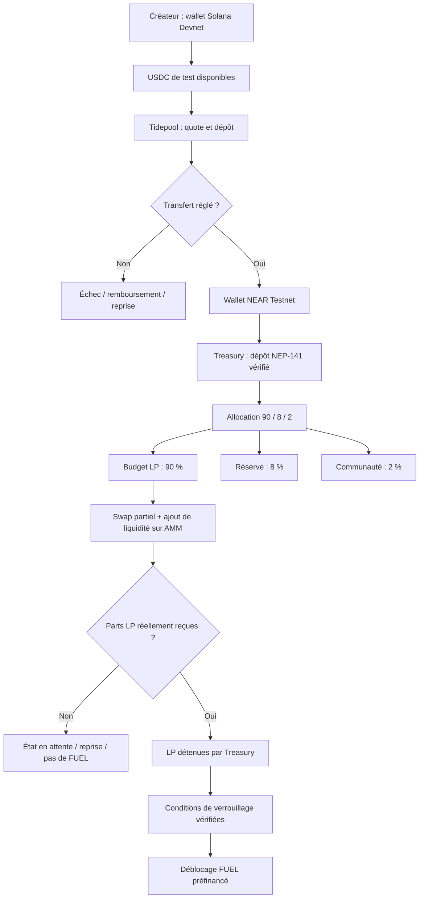
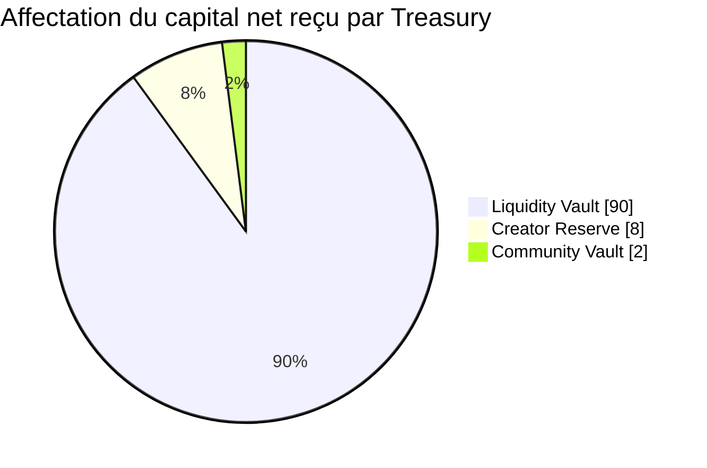
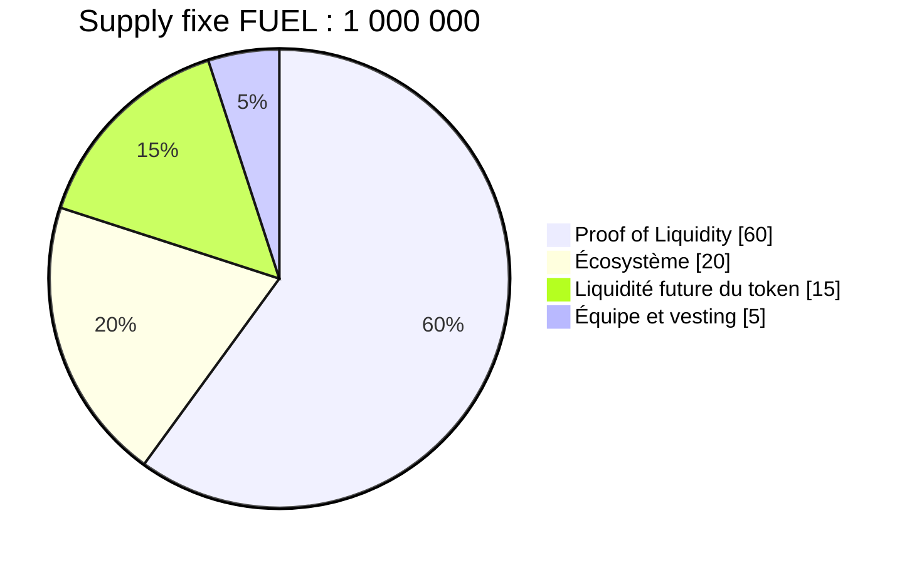
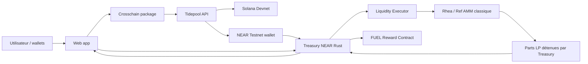

# SOL2NEAR — V3 | Spécification complète du projet

> **Document à partager avec l'équipe avant le développement.** Ce document explique **ce que nous construisons, pourquoi, pour qui, comment cela fonctionne, son économie et les preuves attendues**. Il ne contient pas les prompts de développement : ceux-ci sont rassemblés dans `SOL2NEAR_V3_Workflow_Equipe_Prompt_B1.md`.

| Informations | Détails |
|---|---|
| Projet | **SOL2NEAR** — *Autonomous Memecoin Liquidity Engine* |
| Nature du service | Plateforme web DeFi de gestion de trésorerie et de liquidité cross-chain |
| Hackathon | NEAR Hackathon 2026 |
| Track principal | **Memecoins With Mechanics** |
| Track complémentaire à examiner | Unstoppable DeFi, sous réserve des règles de soumission |
| Équipe | 2 développeurs — responsable principal 70 %, coéquipier 30 % |
| Environnement de démonstration | **Solana Devnet → Tidepool → NEAR Testnet** |
| Date de soumission | **14 novembre 2026, 23:59 UTC** (15 novembre à 00:59, Paris) |
| Version | **V3 — spécification produit et économique, sans code** |
| Statut | Objectif et architecture **proposés** ; les intégrations effectives doivent être prouvées |

---

## 1. Le projet en 30 secondes

### One-liner

> **SOL2NEAR turns Solana memecoin creator revenue into verifiable, programmable liquidity on NEAR.**

### Pitch court (français)

Solana dispose d'une forte activité de trading de memecoins. Certains créateurs touchent des frais de transactions grâce à cette activité. **SOL2NEAR** leur permet de **réinvestir volontairement** une partie de ces revenus sur NEAR en quelques étapes : transférer des USDC depuis Solana, appliquer des règles de trésorerie, financer un pool de liquidité et prouver onchain la propriété des parts LP. Une mécanique communautaire, **FUEL**, peut récompenser les liquidités effectivement déposées et verrouillées.

**Ce que nous ne faisons pas :** créer un nouveau Pump.fun, prétendre être un bridge indépendant, récupérer les frais de tiers sans autorisation, ou promettre un rendement.

### Pitch anglais pour le jury

> Memecoin creators generate fees on Solana, but those earnings rarely become transparent, long-term liquidity on other ecosystems. SOL2NEAR routes creator-authorized USDC from Solana into a programmable treasury on NEAR, allocates it under enforceable rules, deploys it into real AMM liquidity, and verifies the resulting LP ownership onchain. FUEL adds a rules-based community mechanism tied to verified liquidity rather than price speculation.

### Le problème que nous résolvons

1. **Friction cross-chain :** convertir des revenus Solana en positions DeFi NEAR implique plusieurs étapes manuelles.
2. **Manque de transparence :** il est difficile de prouver quelle part d'une contribution a réellement été déployée en liquidité, plutôt que simplement bridgée.
3. **Liquidité peu durable :** des campagnes peuvent générer des flux sans laisser de positions productives vérifiables.
4. **Absence d'automatisation de trésorerie :** les communautés n'ont pas toujours des règles de répartition applicables automatiquement.

**Notre innovation :** connecter **des revenus contrôlés par leur bénéficiaire**, **une infrastructure cross-chain**, **une trésorerie onchain** et **une preuve de liquidité effective** dans un produit unique.

---

## 2. Quelle forme prend le service ?

SOL2NEAR est **un site web / dashboard DeFi destiné aux créateurs et trésoreries de communautés**. Ses fonctions combinent trois infrastructures existantes :

| Infrastructure | Rôle | Ce que SOL2NEAR ajoute |
|---|---|---|
| Pump.fun / Bags / autres launchpads Solana | Éventuelles sources de frais perçus par les créateurs | Une destination et une stratégie de réinvestissement, **avec leur accord** |
| NEAR Intents / API 1Click | Routage et transfert cross-chain en production | Orchestration du parcours, traçabilité, affectation et interface |
| Tidepool | Environnement **communautaire de test** compatible 1Click | Démonstration Solana Devnet → NEAR Testnet sans fonds réels |
| Rhea / AMM compatible | Swaps et fourniture de liquidité | Cofre contrôlant les LP, règles économiques, suivi des positions |
| FUEL (notre contrat) | Récompenses programmables | Déclenchements dépendant de LP **vérifiées** |

**Positionnement :** *Cross-Chain Liquidity Management Platform* et non « launchpad » ou « bridge » autonome.

### Utilisateurs de la V1/V3

- **Primaire :** un créateur de memecoin Solana possédant déjà des USDC ou des revenus qu'il contrôle.
- **Secondaire :** une communauté, DAO ou créateur souhaitant développer une présence économique sur NEAR.
- **Futur :** des launchpads et collectifs qui souhaitent automatiser plusieurs stratégies.

**Limite assumée :** le MVP ne sait pas prouver automatiquement qu'un dépôt provient précisément de *creator fees*. Il démontre l'apport volontaire depuis Solana. La collecte automatisée des frais est prévue après le hackathon.

---

## 3. Le parcours utilisateur complet

### Parcours normal

1. Le créateur visite le site et connecte son wallet **Solana Devnet** et son compte **NEAR Testnet**.
2. Il obtient des USDC de test via les faucets adaptés ; il dispose séparément d'un peu de SOL Devnet et de NEAR Testnet pour le gas et le stockage.
3. Il sélectionne le montant d'USDC à transférer et consulte une **cotation Tidepool** avec frais et montant attendu.
4. Il signe **volontairement** la transaction depuis son wallet Solana.
5. L'application suit l'opération jusqu'à `SUCCESS`, `FAILED` ou `REFUNDED`, sans inventer de succès.
6. Après réception, l'utilisateur **dépose les USDC reçus** dans la trésorerie NEAR via un transfert de token vérifié.
7. Le coffre calcule l'allocation **90 % liquidité / 8 % réserve / 2 % communauté** en unités atomiques.
8. La part liquidité permet d'obtenir la proportion des deux actifs du pool, puis de **créer de véritables parts LP** sur un AMM testnet compatible.
9. Le smart contract Treasury **possède les parts LP** et publie les quantités confirmées et les droits économiques du créateur.
10. La mécanique FUEL ne déverrouille ses récompenses qu'après la **vérification de l'apport LP et de ses conditions**.
11. Le dashboard affiche les transactions et distingue clairement capital transféré, capital reçu, liquidité déployée, réserve, frais et récompenses.

### Diagramme du parcours



### Une distinction essentielle

Un **transfert cross-chain réussi** n'est pas une preuve de LP réussie. Une **allocation comptable de 90 %** n'est pas une preuve que cette somme a réellement rejoint un pool. Chaque étape possède son propre statut et sa propre preuve.

---

## 4. Économie du protocole : les trois niveaux

Nous séparons trois activités financières :

1. **Revenus du créateur sur Solana :** des frais lui reviennent éventuellement au titre de son token.
2. **Capital transféré et investi :** il décide combien envoyer à NEAR et financer en LP.
3. **Frais générés par les LP Rhea :** les pools peuvent accumuler des frais en fonction de leur volume réel. Ces frais ne sont **pas** du capital externe supplémentaire transféré depuis Solana.

### 4.1 Les frais du créateur ne sont pas uniformes

Les conditions Pump.fun évoluent selon les mécanismes et les tranches de capitalisation. La grille publiée le 17 octobre 2026 donne notamment **0,30 % de creator fee en bonding curve**, tandis que certaines tranches PumpSwap sont à d'autres taux, y compris **0,95 %** ou **0,05 %**. Le projet devra donc raisonner sur **les revenus effectivement perçus**, jamais calculer un droit de prélèvement sur la base d'un volume estimé.

Exemple purement illustratif :

| Variable | Hypothèse |
|---|---:|
| Volume hebdomadaire Solana | 1 000 000 $ |
| Taux effectif de revenu du créateur | 0,30 % |
| Revenu réellement encaissé | 3 000 $ |
| Part volontairement réinvestie | 40 % |
| Somme envoyée vers NEAR | **1 200 USDC** |

Formules :

\[
R = V \times f_c, \quad D = R \times p
\]

- `V` : volume de trading du token ;
- `f_c` : taux **effectif** de frais revenant au créateur ;
- `p` : proportion des revenus que le créateur souhaite réinvestir ;
- `D` : montant volontairement envoyé.

Le taux de 40 % est un exemple **de choix du créateur**, pas une retenue imposée par SOL2NEAR.

### 4.2 Allocation de trésorerie retenue en V3 : 90 / 8 / 2



| Budget | Poids | Destination | Droit économique |
|---|---:|---|---|
| **Liquidity Vault** | **90 %** | Fonds destinés à une position AMM | Créateur, via une créance/position enregistrée dans Treasury |
| **Creator Reserve** | **8 %** | Réserve de trésorerie | Créateur, suivant les conditions de retrait fixées |
| **Community Vault** | **2 %** | Budget communautaire préfinancé | Bénéficiaires/règles définis au lancement du coffre |

Les **90 %** maximisent l'apport de liquidité ; les **8 %** maintiennent une réserve contrôlée par le créateur ; les **2 %** fournissent un budget communautaire limité. Ces pourcentages sont **notre choix de conception**, pas un standard Rhea ou une recommandation officielle.

**Les frais techniques (bridge, swap, gas, storage) sont comptabilisés à part** : ils ne sont pas automatiquement prélevés sur la réserve du créateur ni assimilés à des revenus du protocole.

#### Arithmétique onchain

La base de calcul est le montant exact d'USDC **réellement crédité** au contrat Treasury, en unités atomiques (USDC : 6 décimales pour le token Tidepool documenté). Pour un dépôt `A` :

```text
LP        = floor(A × 9000 / 10000)
Reserve   = floor(A ×  800 / 10000)
Community = A − LP − Reserve
```

- 9 000 basis points (bps) de LP ;
- 800 bps de réserve ;
- le complément (normalement 200 bps, plus résidus d'arrondi) en budget communauté.

On obtient toujours `LP + Reserve + Community = A`, sans perte de poussière arithmétique et sans flottants.

#### Exemple : 20 USDC déjà reçus sur NEAR

| Catégorie | Montant |
|---|---:|
| USDC net reçu par Treasury | 20,00 |
| Budget LP (90 %) | **18,00** |
| Réserve créateur (8 %) | **1,60** |
| Budget communauté (2 %) | **0,40** |

Pour un pool classique équilibré NEAR/USDC, il faudra approximativement **9 USDC + 9 $ de wNEAR** au moment de l'opération, avant frais et ajustement du ratio effectif du pool. Les **18 USDC constituent un budget**, pas une preuve que 18 $ de LP ont été effectivement créées.

### 4.3 Coûts et rendement : le bon calcul

```text
Capital envoyé depuis Solana
  − coût cross-chain effectif
= montant net reçu sur NEAR
  × 90 %
= budget prévu pour LP
  − coûts de conversion, exécution et slippage
= valeur effectivement déployée dans le pool
```

Les coûts doivent provenir des **devis et transactions réels**, et non de taux gravés dans le code. L'API Tidepool a sa propre grille de frais de test ; l'API 1Click mainnet peut avoir une grille différente.

Les pools classiques Rhea documentent qu'**environ 80 % des frais de swap du pool sont destinés aux LP**, le reste étant affecté au protocole et/ou au referral. Il ne faut pas confondre :

- taux de swap **du pool** ;
- fraction des frais reversée aux LP ;
- part de la LP du coffre dans **l'ensemble** du pool.

Formule illustrative, sans garantie de rendement :

\[
\mathrm{Frais\ LP\ journaliers} \approx
V_{\mathrm{pool,jour}} \times f_{\mathrm{swap}} \times \alpha_{\mathrm{LP}}
\times \frac{L_{\mathrm{coffre}}}{\mathrm{TVL}_{\mathrm{pool,après\ dépôt}}}
\]

La volatilité des actifs et la **perte impermanente** peuvent dépasser les frais accumulés. Un pool peu actif peut générer très peu de frais.

### 4.4 Revenus du protocole SOL2NEAR

**Hackathon : 0 % de commission SOL2NEAR.** L'objectif est de prouver le fonctionnement, sans complexifier la comptabilité.

Après le hackathon, une hypothèse à étudier serait **0,10 % sur le montant net effectivement déployé en LP**, affiché avant la transaction :

| LP financées dans le mois | Commission hypothétique brute à 0,10 % |
|---|---:|
| 10 000 $ | 10 $ |
| 100 000 $ | 100 $ |
| 1 000 000 $ | 1 000 $ |

Ce sont des **scénarios non validés commercialement**, avant frais d'infrastructure, audit, support et obligations réglementaires. L'API 1Click peut appliquer des frais distincts.

---

## 5. Qui possède le capital et les LP ?

Nous choisissons un modèle **creator-owned liquidity** pour le MVP.

- Le créateur apporte volontairement ses USDC.
- Le contrat Treasury détient **techniquement** les LP sur l'AMM.
- Le contrat tient un registre du **droit économique du créateur** sur les parts LP, avec les contraintes de verrouillage et de retrait.
- Le créateur ne peut retirer que ce qui lui appartient et seulement selon les règles définies.
- Aucun administrateur du projet ne doit pouvoir transférer arbitrairement les LP vers sa propre adresse.
- La réserve 8 % est affectée au créateur ; le budget 2 % suit les règles communautaires préétablies.

**Ne pas écrire « community-owned liquidity » dans le pitch V3 :** ce serait faux si les LP appartiennent économiquement au créateur. Une treasury irrévocablement communautaire pourra être étudiée ultérieurement.

### Verrouillage

- **Production envisagée :** 30 jours initialement, paramétrés à la création du coffre.
- **Testnet / démonstration :** délai accéléré prédéfini et identifié comme paramètre **de test**, pour pouvoir prouver un cycle avant le 14 novembre.
- Un administrateur ne doit pas pouvoir raccourcir a posteriori un verrouillage déjà actif.

---

## 6. FUEL — Memecoin With Mechanics

FUEL n'est **pas** un dividende ni une promesse de rendement. C'est un token NEP-141 avec une **supply fixe** dont une réserve préémise est libérée selon des règles vérifiables de *Proof of Liquidity*.

### Tokenomics proposées

**Supply totale : 1 000 000 FUEL, sans mint supplémentaire.**



| Catégorie | Part | Tokens |
|---|---:|---:|
| Réserve Proof of Liquidity | 60 % | 600 000 |
| Écosystème | 20 % | 200 000 |
| Liquidité future FUEL | 15 % | 150 000 |
| Équipe (vesting) | 5 % | 50 000 |
| **Total** | **100 %** | **1 000 000** |

### Mécanisme proposé

- 1 FUEL **en unités de récompense** par USDC de composante stablecoin effectivement présent dans une position LP nouvellement créée et admissible ;
- plafond proposé de **2 000 FUEL par coffre et période de 30 jours**, sous réserve du plafond de la réserve et d'éventuels plafonds globaux ;
- la récompense est calculée sur la **liquidité nette vérifiée**, pas sur le montant du devis ou le budget LP ;
- le déblocage intervient après les conditions de verrouillage établies ;
- un retrait/redépôt du même capital ne doit pas créer plusieurs droits à récompense ;
- le protocole doit connaître le propriétaire de la LP et refuser une prétendue « preuve » provenant du frontend.

**Point d'attention à concevoir avant implémentation :** définir formellement l'identification du capital nouveau et le plafond global par période ; une simple limitation « par wallet » est contournable. La première version peut restreindre les coffres autorisés, mais doit l'annoncer.

### Pourquoi FUEL est utile au track

Le guide du track valorise des **règles programmables et vérifiables** : notre token doit réagir à une action onchain vérifiée, au lieu de se limiter à un visuel de memecoin ou à son graphique de prix.

---

## 7. Architecture technique

### Systèmes et responsabilités

| Élément | Technologie cible | Fonction |
|---|---|---|
| Interface | Next.js / React / TypeScript | Wallets, cotations, dashboard, navigation et preuves |
| Connecteur Solana/Tidepool | TypeScript isolé | Route, devis, signature wallet, dépôt, statuts, erreurs |
| Treasury | Rust / NEAR SDK | Réception NEP-141, 90/8/2, permissions, états et comptabilité |
| Liquidity Executor | Module logique Rust, éventuellement regroupé avec Treasury | Conversion, dépôts AMM, ajout de liquidité, contrôle des retours |
| AMM | Rhea/Ref classique testnet **si compatible** | Création et conservation de parts LP |
| FUEL | Contrat NEP-141 Rust | Supply fixe et récompenses conditionnelles |
| Documentation et tests | Markdown + tests Rust/TypeScript | Reproductibilité et preuve des fonctionnalités |

### Diagramme des composants



### États à distinguer impérativement

```text
QUOTE_READY
→ SOURCE_TX_SUBMITTED
→ CROSSCHAIN_PENDING
→ CROSSCHAIN_SUCCESS / CROSSCHAIN_FAILED / REFUNDED
→ NEAR_WALLET_RECEIVED
→ TREASURY_DEPOSIT_CONFIRMED
→ BUDGET_ALLOCATED
→ SWAP_PENDING
→ AMM_DEPOSIT_PENDING
→ LP_CONFIRMED
→ LP_LOCKED
→ FUEL_ELIGIBLE
→ FUEL_CLAIMED
```

**Idempotence :** une même transaction / un même callback rejoué ne doit pas créditer deux fois un dépôt ou un droit FUEL. Les opérations asynchrones nécessitent des états de reprise et des contrôles de résultat.

### Environnement et tokens de test

Au 11 novembre 2026, la documentation Tidepool mentionne notamment :

- USDC **sur NEAR Testnet** : `usdc.tidepool-sandbox.testnet` — **6 décimales** ;
- wNEAR **sur NEAR Testnet** : `wnear.tidepool-sandbox.testnet` — **24 décimales** ;
- USDC **SPL sur Solana Devnet** : mint documenté `7pafEGXSmR35rLKNaD6inpfLYuEnRX9DyBc1c7M8r4Xr` — **6 décimales** ;
- vérificateur Tidepool sur NEAR Testnet : `verifier.tidepool-sandbox.testnet` ;
- contrat AMM de test mentionné par Rhea : `ref-finance-101.testnet`.

**Attention :** l'USDC reçu via Tidepool n'est **pas** l'USDC Circle mainnet, et le wNEAR Tidepool n'est **pas** `wrap.near` mainnet. Les routes et adresses doivent être revalidées dans la documentation et les résultats réseau au moment de coder. Les tokens de test n'ont pas de valeur.

### Le point de faisabilité critique

**Le contrat `ref-finance-101.testnet` accepte-t-il les deux tokens Tidepool et permet-il d'obtenir des LP détenues par Treasury ?**

Tant que ce point n'est pas démontré, il faut conserver un plan de repli :

1. Tenter l'utilisation ou la création d'un pool classique sur l'AMM de test Rhea, avec les comptes et dépôts de storage nécessaires.
2. Si non faisable, déployer une **instance de démonstration** de l'AMM open source Ref/compatible, en indiquant qu'il ne s'agit pas du Rhea officiel.
3. En dernier recours, garder un adaptateur **simulé uniquement en test local**, et déclarer l'intégration LP réelle comme **incomplète** dans le README et la démo.

Une interface qui affiche des LP fictives ne satisfait **pas** le critère de preuve onchain.

---

## 8. Sécurité et garde-fous

### Priorités absolues

- **Aucune clé privée, seed phrase, wallet JSON, `.env` sensible ou jeton confidentiel dans Git.**
- **Aucun fonds réel** dans Tidepool ; c'est un environnement communautaire avec des composants de relayer et de dépôt custodial de test.
- Aucun déploiement onchain ou transfert signé sans validation humaine explicite.
- Montants en unités atomiques, pas en `float` ou conversion de précision incertaine.
- Validation explicite du contrat NEP-141 autorisé lors des dépôts.
- Séparer allocations **comptables**, fonds **réellement déposés dans l'AMM**, et **LP détenues**.
- Vérifier le solde réel de parts LP et les retours du DEX, pas les affirmations d'un backend.
- Bloquer les doubles dépôts et callbacks rejoués ; conserver les états intermédiaires.
- Définir clairement les droits de retrait du créateur, le verrouillage et le rôle des administrateurs.
- Limiter le slippage et refuser les opérations hors contraintes.
- Prévoir des fonds **gas/storage** testnet séparés de la réserve du créateur.

### Exemple de tests indispensables

| Scénario | Résultat attendu |
|---|---|
| USDC de test autorisé reçu | Dépôt comptabilisé une seule fois |
| Faux dépôt déclaré par frontend | Aucun crédit |
| Mauvais token NEP-141 | Refus / retour selon mécanisme du transfert |
| Arrondis sur petits montants | 90/8/2 déterministe, conservation du total |
| Retrait non autorisé | Refus |
| Appel AMM échoué | Fonds non marqués comme LP déployées |
| Callback AMM répété | Aucun double crédit de LP |
| Citation de « preuve LP » non confirmée | Aucun FUEL débloqué |
| Lock non terminé | Retrait interdit |
| Récompense FUEL réclamée deux fois | Deuxième demande rejetée |
| Erreur ou remboursement Tidepool | Statut correct et absence de dépôt fictif |

### Risques économiques

Les LP sont soumises à la volatilité des actifs, au **slippage** et à la perte impermanente. La présence d'une LP ne signifie pas que son capital initial en dollars est préservé. Les taux affichés ne doivent jamais être présentés comme des rendements garantis.

---

## 9. Fonctionnalités du site et UX

### Pages / modules du frontend

**A. Landing**

- One-liner et explication en trois étapes.
- Indication « TESTNET DEMO » sans ambiguïté.
- Lien vers la documentation et les contrats utilisés.
- Bouton *Connect wallets*.

**B. Creator Dashboard**

- Wallet Solana Devnet et compte NEAR Testnet.
- Revenus / montants volontairement disponibles (sans prétendre détecter automatiquement les creator fees).
- Total envoyé, reçu, alloué, investi.
- Positions LP confirmées et récompenses FUEL conditionnelles.

**C. Revenue Router**

- Actif source : USDC Solana Devnet.
- Montant en USDC et équivalent en unités atomiques.
- Cotation Tidepool, frais, expiration, montant attendu.
- Confirmation et signature explicite ; suivi des statuts.
- Lien transaction Solana et confirmation côté NEAR.

**D. Treasury**

- Vue 90 % / 8 % / 2 % avec les **montants réels**.
- Solde disponible, budget LP en attente, réserve, communauté.
- Liste d'opérations et état de chacune.

**E. Liquidity**

- Pool cible, actifs précis, ratio, frais et limites de slippage.
- Budget alloué vs LP réellement créées.
- Parts LP détenues et verrouillage restant.
- Erreurs d'exécution et possibilités de reprise sûres.

**F. FUEL**

- Supply fixe, réserve de récompenses, conditions de libération.
- Liquidité éligible vérifiée ; récompenses admissibles et réclamées.
- Aucune conversion implicite FUEL = USD.

### Direction artistique

- Thème sombre, esthétique trading/DeFi.
- Accents vert NEAR, détails Solana en dégradé discret.
- Priorité à la lisibilité : chiffres, états, réseaux et preuves.
- Animations légères et utilement liées aux confirmations de transferts.
- Pas de métriques inventées, de faux PnL ni d'APR affiché comme acquis.

---

## 10. Périmètre du MVP pour le hackathon

### Obligatoire — P0

1. Dossier GitHub reproductible avec README précis.
2. Connecteur Tidepool capable de récupérer les actifs et un devis ; transfert testnet réel **si route disponible et avec autorisation utilisateur**.
3. Dépôt d'USDC de test dans Treasury via transaction NEP-141 vérifiable.
4. Allocation 90/8/2 correcte, avec valeurs affichées sur le site.
5. Intégration LP AMM : **objectif prioritaire** de création et propriété de parts réelles ; état de limitation explicitement affiché si le blocage technique n'est pas levé.
6. Tests Rust et TypeScript critiques.
7. Dashboard présentant les étapes exactes, les transactions et les échecs.

### Souhaité — P1

- FUEL NEP-141 préémis et mécanique Proof of Liquidity vérifiable.
- Démonstration d'un lock accéléré sur testnet.
- Tests de bout en bout incluant une erreur et sa récupération.

### Exclu de la V3 / après hackathon — P2

- Claim automatique des creator fees Pump.fun ou Bags.
- Chain Signatures et opérations Solana complètement autonomes.
- Multiples créateurs simultanés et multiples stratégies de pools.
- Pools de memecoins illiquides, market making, rebalancing automatisé.
- Bridge mainnet ou gestion d'argent réel.
- DAO complète, abonnements et commissions avancées.

**Priorité stratégique :** prouver un chemin complet sur une petite somme testnet plutôt que développer dix écrans autour de transactions fictives.

---

## 11. Difficultés techniques et plans de secours

| Difficulté | Plan A (préféré) | Plan B crédible |
|---|---|---|
| Route Solana Devnet temporairement inactive | Relecture `/v0/tokens`, devis et santé API | Tester les fonctions Tidepool avec mocks ; annoncer la route indisponible, pas simuler un succès réel |
| Absence de gas testnet | Faucet Solana / NEAR | Préfinancer les comptes avec des tokens de test via un autre faucet autorisé |
| Token Tidepool incompatible avec un pool Rhea | Créer / utiliser un pool autorisé sur Rhea testnet | Instance AMM Ref open source dédiée, signalée comme démonstration |
| Ratios et conversion LP complexes | Un seul pool et une seule stratégie, limites de slippage | Préparer les actifs et dépôts en étapes distinctes puis reprendre après confirmation |
| Callbacks NEAR asynchrones | Machine à états et tests de rejouabilité | Exécution manuelle autorisée des étapes indépendantes, sans falsifier le statut |
| Double comptage de dépôt | Réconciliation sur token effectivement reçu + ID d'opération | Bloquer l'opération et rapprocher les soldes avant reprise |
| Proof-of-Liquidity FUEL difficile | Vérification des LP détenues et du verrouillage par Treasury | Remettre les récompenses à P1, mais ne jamais les attribuer sans preuve |
| Dépendance au module coéquipier | Interface TypeScript partagée et mocks clairement marqués | Intégration tardive derrière un adapter sans modifier le cœur Rust |
| Contraintes de temps et crédits | Gros checkpoints, tests ciblés, documentation persistante | Réduire l'UI et garder le flux transactionnel prioritaire |

---

## 12. Travail à deux (70 % / 30 %)

Le détail des prompts, de Git et du handoff figure dans **`SOL2NEAR_V3_Workflow_Equipe_Prompt_B1.md`**. Ici, seule la séparation fonctionnelle est nécessaire.

| Responsable A — Lead (70 %) | Responsable B — Cross-chain (30 %) |
|---|---|
| Architecture, coordination, configuration du repo | Module TypeScript Tidepool / Solana |
| Treasury Rust et allocation | Tokens et décimales, devis, transfert |
| Intégration Rhea/Ref et propriété LP | Wallet Solana et signatures volontaires |
| FUEL et preuves économiques | Suivi des statuts, remboursements, erreurs |
| Frontend, tests E2E, démo et soumission | Tests du module et `CROSSCHAIN_HANDOFF.md` |

### Structure du dépôt

```text
sol2near/
├── apps/
│   └── web/                     # Lead
├── contracts/
│   ├── treasury/                # Lead
│   └── fuel/                    # Lead
├── packages/
│   ├── crosschain/              # Équipier
│   └── shared/                  # Interface commune
├── docs/
│   ├── ARCHITECTURE.md
│   ├── FEASIBILITY.md
│   └── crosschain/
│       └── CROSSCHAIN_HANDOFF.md
├── tests/
├── CHECKPOINT.md
└── README.md
```

### Branches et handoff

- `main` : stable.
- `feat/core` : lead.
- `feat/crosschain` : équipier.
- L'équipier travaille exclusivement dans `packages/crosschain` et `docs/crosschain` (sauf accord explicite sur les fichiers partagés).
- Il termine par des tests et un document `CROSSCHAIN_HANDOFF.md` ; il propose une Pull Request.
- Le lead révise et intègre le module dans le frontend.
- Les prompts sont découpés en **3 checkpoints majeurs**, pas une validation par petite fonction.

---

## 13. Définition du succès et preuves pour le jury

### Checkpoint 1 — Core Protocol

- Faisabilité documentée et bloqueurs identifiés.
- Treasury Rust et allocation 90/8/2 testés.
- Intégration AMM avancée au maximum vers des LP réellement détenues.
- Module cross-chain développé en parallèle par l'équipier.
- États et événements permettant d'auditer le flux financier.

### Checkpoint 2 — Application complète

- Wallets et interface branchés.
- Module Tidepool intégré.
- Flux testnet de bout en bout, avec preuves si la route est disponible.
- FUEL fonctionnel et uniquement si ses préconditions sont remplies.

### Checkpoint 3 — Qualité / soumission

- Tests, audit des chemins d'erreur, README, vidéo et liens de transaction.
- Dépôt GitHub public.
- Démonstration sur X et soumission avant la deadline officielle.

### Critères d'acceptation

| Preuve attendue | Comment la montrer |
|---|---|
| Solana → NEAR testnet | Tx source et état Tidepool effectivement réglé |
| Dépôt NEP-141 dans Treasury | Tx et solde du contrat |
| Allocation 90/8/2 | Méthodes de lecture et calcul reproductible |
| LP réellement créée | Tx AMM et lecture de balance LP du coffre |
| Propriété économique | Règles de retrait + registre onchain |
| Récompense FUEL | Tx et précondition LP confirmée, absence de double claim |
| Robustesse | Suite de tests exécutée et sortie vérifiable |
| Transparence | README distinguant réel / testnet / fallback / simulation |

### Démo de trois minutes : storyboard

1. **0:00–0:25 — Problème :** revenus Solana, manque de liquidité programmable sur NEAR.
2. **0:25–0:55 — Connexion :** wallet Solana Devnet, montant USDC test et cotation Tidepool.
3. **0:55–1:25 — Cross-chain :** transfert, statut et réception NEAR Testnet.
4. **1:25–1:55 — Treasury :** dépôt, 90/8/2 et preuves onchain.
5. **1:55–2:25 — AMM :** position LP réellement créée, détenue par le smart contract.
6. **2:25–2:45 — FUEL :** mécanisme débloqué uniquement si la preuve LP existe.
7. **2:45–3:00 — Conclusion :** architecture réutilisable, roadmap automatisation des creator fees.

Ce storyboard est **cible** : si une étape reste non fonctionnelle, la démo doit l'indiquer sans la maquiller.

---

## 14. Roadmap après le hackathon

**Phase suivante — V4 :** intégration autorisée des comptes de perception de frais Solana, rapprochement des montants encaissés, exécution périodique fiable, opérations multi-pools et contrôle des coûts.

**Long terme — V5 :** gestion multi-créateurs et multi-chaînes, stratégies de pools memecoins NEAR, reporting auditable, infrastructure pour launchpads/DAOs et modèle commercial validé.

Le passage vers la production demanderait en plus des audits de sécurité, une analyse juridique et réglementaire, des politiques de gestion du risque et des preuves de revenus récurrents réels.

---

## 15. Hypothèses à ne pas transformer en faits

1. Tidepool est **communautaire**, non exploité officiellement par NEAR Intents. Sa compatibilité d'API ne signifie pas équivalence de sécurité ni de fonctionnement avec le mainnet.
2. Les tokens Tidepool n'ont aucune valeur marchande et ne doivent jamais recevoir de fonds mainnet.
3. La **disponibilité d'une route live** doit être recontrôlée au développement, même si elle figure dans la documentation.
4. L'AMM Rhea testnet est documenté ; **la compatibilité exacte des tokens Tidepool et l'existence du pool cible restent à tester**.
5. Le montant de LP détenu et ses frais ne doivent pas être déduits d'une simple intention d'opération.
6. Le 90/8/2, le ratio FUEL, le verrouillage et la commission 0,10 % future sont des **choix de conception proposés**, non des paramètres imposés par des protocoles externes.
7. Les fonds de démonstration viennent de faucets/testnets, pas de revenus Pump.fun réels. Le pitch parle de **cas d'usage**, la démo parle de **ce qui fonctionne effectivement**.

---

## 16. Références et documentation à conserver dans le repo

Sources consultées au 11 novembre 2026 :

- NEAR Hackathon : https://nearhackathon.com/
- Documentation NEAR : https://docs.near.org/
- NEAR Intents 1Click — quickstart : https://docs.agentsonintents.com/integration/distribution-channels/1click-api/quickstart/introduction
- Tidepool — introduction et trust model : https://www.usetidepool.tech/docs
- Tidepool — tokens et contrats : https://www.usetidepool.tech/docs/resources/tokens
- Tidepool — quickstart : https://www.usetidepool.tech/docs/quickstart
- Tidepool — fonctionnement : https://www.usetidepool.tech/docs/concepts/how-it-works
- Rhea — contrats mainnet/testnet : https://guide.rhea.finance/developers/contracts
- Rhea — pools classiques et répartition des frais : https://guide.rhea.finance/near-chain-guides/liquidity-pools/classic-pools
- Pump.fun — frais créateur : https://pump.fun/docs/fees
- Ref Finance — documentation technique : https://github.com/ref-finance/docs

---

## 17. Décisions finales de la V3

| Sujet | Décision |
|---|---|
| Produit | **Site DeFi / treasury management**, pas un launchpad |
| Source | **USDC Solana Devnet** dans la démo |
| Infrastructure test bridge | **Tidepool** compatible 1Click, communautaire |
| Destination | **NEAR Testnet**, token USDC de test compatible |
| Allocation de capital net | **90 % LP / 8 % réserve / 2 % communauté** |
| Marché cible | Un **AMM classique** compatible Rhea, un seul pool |
| Propriété | **Creator-owned LP**, détenue techniquement par Treasury |
| Récompenses | **FUEL supply fixe**, seulement après preuve LP |
| Commission du hackathon | **0 %** |
| Récolte automatique des creator fees | **Hors MVP** |
| Nombre de développeurs | **2**, responsabilités 70/30 |
| Objectif unique | **Traçabilité Solana → NEAR → LP réelle → règles FUEL** |

> **Phrase de synthèse :** SOL2NEAR n'est pas un simple outil de transfert. C'est un moteur de trésorerie cross-chain qui transforme un capital volontairement apporté depuis Solana en liquidité NEAR **mesurable, détenue par un contrat et gouvernée par des règles vérifiables**.

**Document complémentaire :** `SOL2NEAR_V3_Workflow_Equipe_Prompt_B1.md` — répartition Git, prompts Claude Code, interfaces, checkpoints et handoff.
