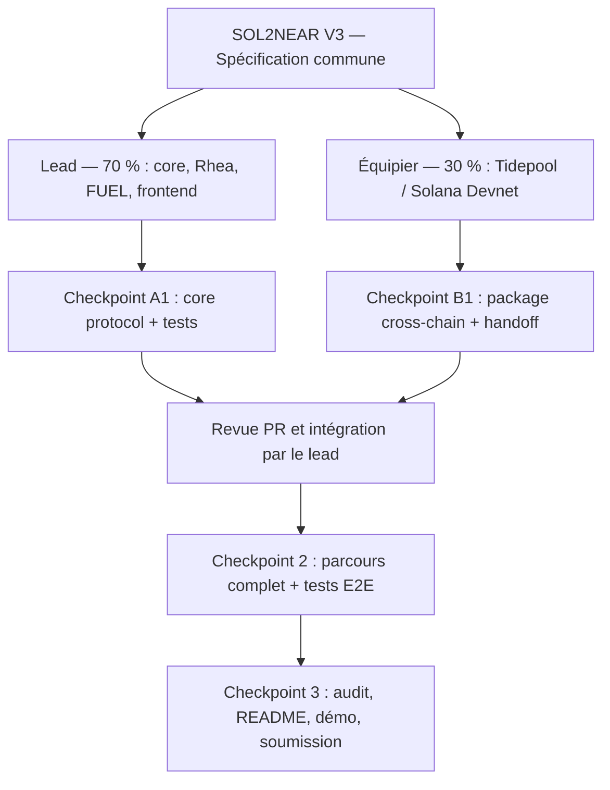

# SOL2NEAR V3 — Workflow d'équipe et prompt Claude Code B1

**Projet :** SOL2NEAR — Autonomous Memecoin Liquidity Engine  
**Hackathon :** NEAR Hackathon 2026 — *Memecoins With Mechanics*  
**Équipe :** 2 développeurs  
**Répartition cible :** Lead developer 70 % / Cross-chain developer 30 %  
**Statut :** Document de coordination et d'exécution — V3

---

## 1. Principe de fonctionnement

Le lead developer conçoit et intègre le cœur du protocole (smart contracts NEAR, LP, FUEL, frontend). Le second développeur livre un **module cross-chain indépendant**, compatible avec le monorepo, qui permet le transfert de tokens de test entre Solana Devnet et NEAR Testnet via Tidepool.

Le fonctionnement recommandé est simple :

1. Les deux développeurs reçoivent la **spécification SOL2NEAR V3** pour comprendre les objectifs du projet.
2. Chacun reçoit un **gros prompt Claude Code** correspondant à son périmètre.
3. Chacun travaille **de manière autonome jusqu'au checkpoint défini**, avec ses tests et sa documentation.
4. Le second développeur ouvre une **Pull Request** et fournit son rapport `CROSSCHAIN_HANDOFF.md`.
5. Le lead révise, intègre le package dans le frontend et effectue les tests de bout en bout.
6. Les checkpoints suivants sont décidés à partir du code réellement opérationnel, non d'hypothèses.



> **Important :** autonomie ne signifie pas absence de limites. Aucun déploiement onchain, transfert financier, manipulation de clés privées ou opération destructive ne doit être effectué sans accord explicite.

---

## 2. Répartition détaillée 70 % / 30 %

| Domaine | Lead developer — 70 % | Équipier — 30 % |
|---|---|---|
| Architecture globale | Responsable | Respecte les interfaces communes |
| Smart contracts Treasury Rust | Responsable | Hors périmètre |
| Pools Rhea / gestion des LP | Responsable | Hors périmètre |
| Token FUEL et mécanique Proof of Liquidity | Responsable | Hors périmètre |
| Frontend / dashboard | Responsable | Hors périmètre |
| Intégration Tidepool | Intégration finale | **Développement** |
| Solana Devnet et USDC de test | Utilise le package | **Responsable** |
| Cotations / suivi des transactions | Consomme l'API | **Responsable** |
| Tests | Contrats, frontend, bout en bout | Tests du module cross-chain |
| Documentation et livraison | README global, soumission | Handoff technique et documentation du module |

Les pourcentages concernent la **charge de développement estimée**, pas la répartition des prix du hackathon.

### Branches Git

- `main` : état stable et intégré.
- `feat/core` : branche du lead.
- `feat/crosschain` : branche de l'équipier.

L'équipier ne fusionne pas directement dans `main`. Il propose une Pull Request qui sera revue par le lead.

---

## 3. Organisation concrète des deux workflows

### Étape 1 — Partager la V3

Le lead envoie au coéquipier le document de spécification V3. Celui-ci sert à comprendre le produit dans son ensemble, mais ne constitue **pas** une consigne d'implémenter tous les modules.

### Étape 2 — Transmettre le prompt B1 ci-dessous

Le coéquipier ouvre le même repository dans son environnement et donne le prompt B1 à son outil de développement. Il commence par vérifier Tidepool et définit une interface TypeScript claire.

### Étape 3 — Travailler en parallèle

Le lead continue son propre checkpoint sur le Treasury et les LP. L'équipier avance seul sur Tidepool/Solana, corrige ses erreurs et teste son package.

### Étape 4 — Coordonner une seule interface commune tôt

Le seul échange à faire rapidement est la **validation des fonctions/types que le package cross-chain expose au frontend**. Cette interface ne doit ensuite plus changer sans raison documentée.

### Étape 5 — Effectuer le handoff

À la fin, l'équipier transmet :

- sa Pull Request ;
- `docs/crosschain/CROSSCHAIN_HANDOFF.md` ;
- les résultats de tests ;
- les limites et éventuels blocages.

Le lead utilise ces éléments pour brancher le module et préparer le checkpoint suivant.

---

# 4. Prompt Claude Code B1 — À transmettre intégralement à l'équipier

> Copier **tout** le texte de cette section jusqu'à la fin du prompt dans Claude Code, après avoir rendu la spécification V3 accessible dans le repository.

---

## SOL2NEAR V3 — CHECKPOINT B1 : CROSS-CHAIN ENGINE

Tu es un développeur blockchain senior spécialisé dans Solana, TypeScript, NEAR Intents et les infrastructures cross-chain.

Tu participes au NEAR Hackathon 2026 sur SOL2NEAR.

Commence par lire intégralement le document de spécification V3 fourni avec ce prompt.

### 1. CONTEXTE

SOL2NEAR transforme des revenus volontairement apportés par des créateurs de memecoins Solana en liquidité programmable sur NEAR.

Le parcours cible :

**Solana Devnet USDC → Tidepool → NEAR Testnet USDC → Treasury Rust → Rhea AMM → LP.**

Nous sommes deux développeurs.

Le lead developer réalise 70 % du projet et s'occupe des contrats Rust, de Rhea, de FUEL et du frontend.

**Tu réalises les 30 % restants : l'intégralité du module cross-chain.**

### 2. TON PÉRIMÈTRE

Tu es responsable de :

- L'intégration Tidepool, environnement de test compatible avec NEAR Intents 1Click.
- La connexion à Solana Devnet.
- La gestion des USDC SPL de test.
- L'obtention des cotations et la préparation des transactions.
- Le suivi des transferts jusqu'à leur règlement ou remboursement.
- La gestion des erreurs.
- La documentation et les tests du module.

Tu ne développes pas les smart contracts Rust, Rhea, FUEL ou le frontend principal.

### 3. OBJECTIF

Créer un package TypeScript autonome, réutilisable et testé dans :

`packages/crosschain/`

Ce module doit permettre à notre frontend de réaliser le parcours cross-chain sans connaître les détails internes de Tidepool.

### 4. PHASE A — VÉRIFICATION TECHNIQUE

Lis les documentations Tidepool et NEAR Intents.

Vérifie :

- Les endpoints actuellement disponibles.
- La compatibilité Solana Devnet → NEAR Testnet.
- Les contrats et mint addresses des tokens USDC de test.
- Les décimales et les unités atomiques.
- Les conditions des devis.
- La construction des transactions.
- Les statuts de règlement et de remboursement.
- Les limitations de l'environnement.

Rédige `docs/crosschain/FEASIBILITY.md`.

Ne réinvente pas d'API et ne suppose pas qu'un service fonctionne si tu ne peux pas le vérifier.

### 5. PHASE B — PACKAGE TYPESCRIPT

Implémente un module cross-chain propre.

Prévois des interfaces pour :

1. Récupérer les tokens disponibles.
2. Obtenir une cotation de transfert.
3. Vérifier la validité d'une cotation.
4. Préparer une transaction Solana.
5. Demander la signature au wallet utilisateur.
6. Soumettre une transaction autorisée.
7. Suivre les statuts du transfert.
8. Détecter un succès, un remboursement ou un échec.
9. Récupérer les identifiants et preuves de transaction.

Tu peux adapter les noms et interfaces aux API réelles.

Tous les montants doivent utiliser des unités atomiques représentées par des entiers ou des chaînes, jamais des calculs financiers en floating point.

Sépare clairement :

- Les appels réseau ;
- La logique de cotation ;
- Les opérations wallet ;
- Le suivi des statuts ;
- Les types et interfaces ;
- Les erreurs.

### 6. PHASE C — INTERFACE AVEC LE LEAD

Prépare une API publique simple que le frontend pourra utiliser.

Documente les fonctions exportées, leurs paramètres et leurs types de retour.

Fournis un exemple d'intégration sans développer le frontend principal.

Si le contrat d'interface commun n'existe pas encore, propose-le dans `docs/crosschain/INTERFACE.md` afin que le lead puisse le valider rapidement.

Une fois l'interface convenue, évite de la modifier sans raison importante.

### 7. PHASE D — TESTS

Écris et exécute les tests nécessaires.

Vérifie au minimum :

- Une cotation valide ;
- Une cotation expirée ;
- Un montant insuffisant ;
- Un token non supporté ;
- Une erreur réseau ;
- Une transaction rejetée par le wallet ;
- Un statut pending ;
- Un statut success ;
- Un statut failed ;
- Un statut refunded ;
- Une répétition de requête sans double exécution.

Utilise des mocks pour les tests unitaires, mais indique clairement ce qui a été réellement vérifié auprès de Tidepool.

Un test local réussi n'est pas une preuve de transfert cross-chain réussi.

### 8. AUTONOMIE ET CRÉDITS

Tu dois travailler de manière autonome jusqu'à la fin de ce checkpoint.

Ne demande pas de confirmation pour les choix techniques mineurs.

Corrige les bugs et relance les tests pertinents.

Évite les explorations sans rapport, les refactorings inutiles, les sous-agents superflus et les modifications hors périmètre.

Conserve un contexte court et des documents de suivi pour faciliter la reprise des sessions.

Privilégie les tests ciblés avant de lancer une suite complète.

### 9. SÉCURITÉ

- Testnet et Devnet uniquement.
- Aucun vrai fonds.
- Aucune clé privée dans le repository.
- Ne jamais journaliser de seed phrase.
- Aucun transfert sans accord explicite de l'utilisateur.
- Aucun déploiement ou opération destructive sans autorisation.
- Ne pas modifier les dossiers du lead.
- Ne pas inventer de résultat de transaction.
- Ne pas faire de commit de secrets.

Les tests locaux et les requêtes de lecture non destructives sont autorisés.

Pour les transactions signées, prépare le parcours et demande l'accord avant exécution.

### 10. GIT

Travaille sur la branche :

`feat/crosschain`

Ne modifie pas `contracts/`, `apps/web/` ou les fichiers du lead.

Respecte la structure et les conventions du monorepo existant.

Effectue des commits cohérents.

Ne fusionne pas directement dans `main`.

### 11. LIVRABLE FINAL

Crée :

`docs/crosschain/CROSSCHAIN_HANDOFF.md`

Ce document doit contenir :

1. Ce qui est fonctionnel.
2. Les fonctionnalités non terminées.
3. Les routes Tidepool vérifiées.
4. Les token IDs et décimales utilisés.
5. Les fonctions TypeScript exportées.
6. Les instructions d'intégration.
7. Les dépendances.
8. Les tests exécutés et leurs résultats.
9. Les limitations connues.
10. Les transactions testnet réellement confirmées, le cas échéant.
11. Le hash du dernier commit.
12. Les recommandations au lead developer.

Termine avec l'un des statuts :

- `READY TO MERGE`
- `READY WITH LIMITATIONS`
- `BLOCKED`

Tu peux avancer jusqu'à ce livrable sans attendre de nouvelles instructions.

Arrête-toi uniquement si une décision du lead ou une autorisation sensible est indispensable, ou si le checkpoint est achevé.

**Ton objectif n'est pas de construire tout SOL2NEAR : c'est de livrer un excellent module cross-chain, prêt à être intégré et vérifié par le lead.**

---

# 5. Structure du repository et règles anti-conflits Git

```text
sol2near/
├── apps/
│   └── web/                 # LEAD
├── contracts/
│   ├── treasury/            # LEAD
│   └── fuel/                # LEAD
├── packages/
│   ├── crosschain/          # ÉQUIPIER
│   └── shared/              # Interface commune
├── docs/
│   ├── architecture/        # LEAD
│   └── crosschain/          # ÉQUIPIER
└── README.md                # LEAD
```

### Règles de travail

- L'équipier modifie uniquement `packages/crosschain/` et `docs/crosschain/`, sauf accord explicite.
- Le lead est propriétaire de `contracts/`, `apps/web/`, de l'architecture globale et du README.
- Les interfaces de `packages/shared/` doivent être convenues entre les deux développeurs.
- Les modifications au `package.json` racine, à la configuration des workspaces ou aux lockfiles doivent être coordonnées pour éviter les conflits.
- Ne jamais travailler directement à deux sur `main`.
- Préférer les petites Pull Requests cohérentes, sans intégrer du code non testé.
- Documenter chaque changement incompatible d'interface et en prévenir le lead.

### Recommandation de séquencement

1. **Lead :** initialise le monorepo et publie une version stable de sa structure sur `main`.
2. **Équipier :** crée `feat/crosschain` à partir de cette base. Si le monorepo n'est pas encore disponible, il peut commencer par l'audit Tidepool sans créer une structure concurrente.
3. **Équipier :** propose rapidement l'interface publique du module, puis continue ses phases de code et tests.
4. **Lead :** confirme les types attendus et développe le cœur Rust indépendamment.
5. **Équipier :** ouvre la PR avec `CROSSCHAIN_HANDOFF.md`.
6. **Lead :** vérifie les tests et fusionne, puis branche le frontend.

---

# 6. Intégration du module cross-chain

Lorsque le module de l'équipier est terminé :

1. Lire le rapport `docs/crosschain/CROSSCHAIN_HANDOFF.md`.
2. Examiner la Pull Request et vérifier qu'elle ne touche pas le périmètre du lead.
3. Installer les dépendances déclarées et exécuter ses tests.
4. Vérifier que les types publics du package correspondent aux attentes du frontend.
5. Intégrer les fonctions de cotation, préparation, signature et suivi de transfert dans l'application.
6. Vérifier que les opérations sur NEAR ne sont déclenchées que pour des fonds réellement reçus.
7. Tester le parcours de bout en bout, en distinguant clairement les mocks des preuves de transferts réellement confirmés.

**À ce moment-là commence le Checkpoint 2 : application complète et tests E2E.** Le Checkpoint 3 portera ensuite sur l'audit, le README, la démonstration et la livraison.

---

# 7. Vue synthétique des checkpoints

| Checkpoint | Lead | Équipier | Livrable |
|---|---|---|---|
| A1 / B1 | Treasury Rust, comptabilité, Rhea, tests | Tidepool/Solana, API TypeScript, tests | `CHECKPOINT.md` et `CROSSCHAIN_HANDOFF.md` |
| 2 | FUEL, frontend, intégration du module, E2E | Support en cas de bug cross-chain | Application et preuves de flux |
| 3 | Sécurité, finition, docs, démo et soumission | Support final / corrections du module | Repo public, README, démonstration |

### Autonomie recommandée

- **Lead :** un gros prompt par checkpoint ; transmet son rapport pour préparer le suivant.
- **Équipier :** un gros prompt B1, puis travaille de façon autonome jusqu'au handoff ; ne remonte que les blocages structurants.
- **Intégration :** une Pull Request, une revue, puis les tests communs.

L'objectif est de limiter les micro-validations et la consommation de crédits tout en gardant **des frontières claires, une traçabilité des tests et une intégration contrôlée**.

---

## 8. Ce qu'il faut envoyer à l'équipier

1. La **spécification SOL2NEAR V3** (contexte produit et architecture).
2. **Ce document**, contenant les règles de travail et le prompt B1 intégral.
3. Le lien du dépôt GitHub lorsqu'il est prêt.
4. Les conventions de branch et la personne à contacter pour valider l'interface TypeScript.

**Message clé :** le coéquipier possède complètement le module cross-chain, mais pas l'architecture globale. Il travaille en autonomie jusqu'à fournir un package testé, documenté et prêt à intégrer.
