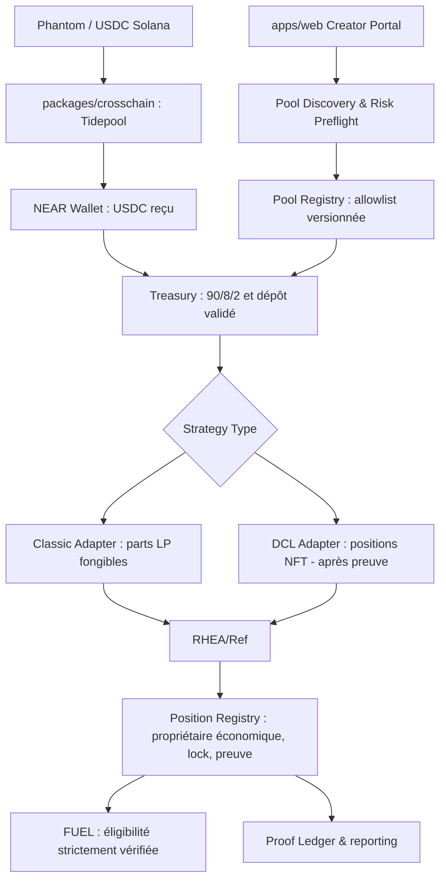

# SOL2NEAR V4 — Memecoin Liquidity Router

> **Spécification produit, économique et technique — décision stratégique et roadmap**  
> **Date :** 13 novembre 2026  
> **Statut :** proposition de V4 ; **aucune fonction V4 n'est présumée implémentée ou déployée**.  
> **Projet :** [SOL2NEAR](https://github.com/nielslecodeur/SOL2NEAR) — développement **solo**.  
> **Environnement de travail :** `C:\Users\niels\OneDrive\fintech\projet\SOL2NEAR`  
> **Hackathon :** NEAR Hackathon 2026, tracks Memecoins With Mechanics et Unstoppable DeFi ; deadline annoncée **14 novembre 2026, 23:59 UTC**.  
> **Règle de gestion :** aucune transaction, signature onchain, mise à jour de contrat ou push Git sans accord explicite de l'utilisateur ; testnet/devnet uniquement pour la démo ; aucun post X, vidéo ou soumission tant que non demandés.

## 0. Décision en une minute

**Définition V4 :** SOL2NEAR devient un **routeur de liquidité spécialisé dans les memecoins NEAR existants**, à destination des créateurs et trésoreries de communautés Solana. Un créateur apporte volontairement des USDC depuis Solana, choisit un **pool NEAR vérifié et compatible**, obtient une position de liquidité dont les droits économiques lui sont attribués, et peut recevoir (1) les **commissions effectives du pool**, qui ne sont jamais garanties, et (2) des **FUEL** conditionnés à une preuve de liquidité et à des limites de distribution.

**Positionnement recommandé :** *“Turn Solana creator capital into verifiable liquidity for NEAR memecoins.”*

**Choix stratégiques :**
1. **Ne pas construire** de bridge, DEX ou launchpad supplémentaire : réutiliser Tidepool/1Click-compatible, RHEA/Ref et les contrats existants.
2. **Ne pas prétendre capter automatiquement les creator fees** de Pump.fun/Bags. V4 accepte des **fonds que le créateur contrôle et transfère volontairement**. L'automatisation des recettes est une évolution ultérieure.
3. **V4.0 = lecture et découverte ; V4.1 = pilote Classic vérifié ; V4.2 = DCL/Nearly si faisabilité démontrée.** Aucun lancement des pools Nearly en prétendant que leur modèle est compatible avec le pool Classic #2951.
4. **Ne pas modifier G2–G5 avant G6–G8.** L'architecture actuelle doit d'abord produire ses preuves E2E réelles.
5. Préserver le split **90 % budget LP / 8 % réserve créateur / 2 % budget communauté** et les règles FUEL existantes tant que leur migration n'a pas été évaluée et autorisée.

**Non-objectifs V4 :** migrer un token Solana sur NEAR, lancer un nouveau memecoin, garantir un APY, lister des pools arbitraires, vendre le token FUEL, promettre un flux Phantom-only déjà fonctionnel, créer des stratégies algorithmiques autonomes ou rééquilibrer continuellement les positions.

---

## 1. Concept initial et état du code annoncé (G2–G5)

### 1.1 La vraie mission initiale

Le projet vise à **apporter des capitaux vers les memecoins de NEAR** en abaissant les obstacles pour les créateurs Solana. Le résultat attendu n'est pas seulement un bridge : c'est un **apport de liquidité vérifiable à une communauté NEAR** avec des droits de propriété identifiables.

Le parcours originel V3 est :

```text
USDC volontaires (wallet Solana Devnet)
 -> Tidepool (bridge de test compatible 1Click)
 -> USDC sur wallet NEAR Testnet
 -> Treasury Rust (90/8/2)
 -> swaps + pool Ref #2951 USDC/wNEAR
 -> parts LP détenues techniquement par Treasury
 -> Proof of Liquidity vérifiée
 -> FUEL admissible / réclamable
```

Ce parcours **ne finance pas encore directement un pool de memecoin NEAR** : il finance un pool USDC/wNEAR. C'est la lacune produit que la V4 entend corriger.

### 1.2 Preuves rapportées et limitations

| Domaine | État communiqué par le développeur | Ne pas confondre avec |
|---|---|---|
| Treasury Rust `treasury.sol2near-dev.testnet` | Cycle C1→C7 onchain, dépôt 20 USDC, allocation 90/8/2, LP #2951 | Support multi-pools |
| FUEL `fuel.sol2near-dev.testnet` | Position et saison vérifiées ; claim 7,74 FUEL ; double claim refusé | Récompenses prouvées pour positions DCL |
| Frontend | Chrome 157 ; 12/12 E2E G5 ; 41 tests web ; Wallet Selector modal réelle | Signature avec un wallet réel |
| Crosschain Tidepool | 35 tests ; devise `live:dry` réelle, quote 1 USDC -> env. 0,9974 USDC | Dépôt réellement transféré depuis Solana |
| Near client | 6 tests, lectures Testnet live | Exécution des signatures dans navigateur |
| Git | Trois commits locaux G3/G4/G5 (`4c77335`, `8b8e6c9`, `8ff834a`) annoncés non poussés | État public du repo à jour |

**Réserve :** ces résultats proviennent des comptes rendus G2–G5 fournis dans la conversation ; ils ne constituent pas ici un audit indépendant du dernier état local.

### 1.3 Architecture conservée

- `packages/crosschain` : Solana + Tidepool, quotes, signature wallet, status, remboursement, persistance.
- `packages/near-client` : appels de lecture NEAR, préparation des transactions.
- `packages/shared` : types, valeurs atomiques, états, conventions.
- `contracts/treasury` : comptabilité 90/8/2, réserves, exécution LP, propriété économique des positions.
- `contracts/fuel` : réserve FUEL préémise, saisons, preuve de liquidité, claims.
- `apps/web` : interface et orchestration des signatures utilisateur.

**Invariants à préserver :** isolation des fonds, arithmétique atomique et arrondis déterministes, idempotence, vérification par états et receipts onchain, chemins de récupération en cas d'échec asynchrone, distinction entre *quoted*, *received*, *allocated*, *invested*, *LP verified* et *rewarded*.

---

## 2. Concurrents : où se spécialiser sans les recopier ?

| Acteur | Déjà couvert par le concurrent | Ce que SOL2NEAR doit apporter en plus | Implication V4 |
|---|---|---|---|
| **RHEA / Ref** | Swaps, pools Classic/DCL, positions LP, frais de trading et farming | **Acquisition des fonds depuis Solana**, accompagnement spécifique des créateurs, comptabilité et droits économiques unifiés | Utiliser le DEX, pas le remplacer |
| **nearly.trade** | Launchpad NEAR avec pool **DCL**, rémunération des créateurs de ses propres tokens ; possibilité de LP supplémentaires séparées du locker de lancement | Financement **externe volontaire depuis Solana** et allocation vers un memecoin **déjà lancé**, sans re-lancement | DCL indispensable à terme ; ne pas confondre *creator fees Nearly* et *frais de notre LP* |
| **Shards** | Taxes de memecoins pouvant alimenter la liquidité du token, ainsi que buybacks et autres allocations | Capital volontaire d'un créateur Solana **vers un pool NEAR choisi**, indépendamment de la taxe interne du launchpad | Ne pas proposer un simple token tax splitter |
| **LI.FI Zaps / Smart Deposit Addresses** | Orchestration d'actions cross-chain et de dépôts dans certains produits compatibles | Curation des pools memecoins NEAR, attribution des positions et Proof of Liquidity | Le *cross-chain zap* n'est pas une invention à revendiquer |
| **NEAR Intents 1Click Earn** | Routage vers certaines positions de rendement via des receipt tokens pris en charge | Spécialisation sur les pools memecoins et positions LP RHEA que 1Click Earn ne liste pas nécessairement | Utiliser les routes accessibles ; ne pas supposer le support de tous les pools |

**Différenciation revendicable avec prudence :** *“a creator-focused, auditable cross-chain memecoin LP workflow”*. **Aucune exclusivité mondiale démontrée.**

**Constat technique décisif :** les pools de lancement Nearly sont sur **RHEA DCL** et leurs positions de LP sont **non fongibles** (NFT de position), tandis que le pilote Ref #2951 utilise des parts LP **fongibles de pool Classic**. Les opérations d'ajout, de suivi, de commissions et de retrait ne se remplacent pas directement.

**Deuxième nuance décisive :** sur Nearly, les tokens optionnellement taxés peuvent prélever une taxe **aussi lors de l'ajout, du retrait de liquidité et de la collecte de frais**. Il faut lire la configuration exacte par token et calculer les montants réellement reçus ; ne pas utiliser un modèle de quote générique qui ignorerait ces prélèvements.

---

## 3. Client cible et promesse produit

### Persona principal

**Créateur ou trésorier d'une communauté memecoin Solana** qui détient déjà des USDC, choisit volontairement d'allouer une partie de son capital à un memecoin NEAR **existant** et veut connaître les droits et risques de sa position.

Le produit n'a pas besoin de prouver que les USDC étaient légalement ou économiquement des *creator fees*. **Il ne doit pas prétendre le contraire.** Le wallet Solana source et la transaction permettent de prouver le transfert, pas l'origine commerciale des fonds.

### Parcours cible V4

1. Arriver sur **Creator Portal**. Message explicite : *“Fund verified NEAR memecoin liquidity using Solana USDC.”*
2. Connecter **Phantom sur Solana Devnet**, vérifier son solde USDC de test et son réseau.
3. Choisir **un pool NEAR autorisé** (vrai nom, contrat FT, DEX, type de pool, volume/TVL si fiables, frais, taxes, risques).
4. Saisir un montant. Voir les frais bridge, le **net estimé reçu**, le split 90/8/2, les swaps nécessaires et les coûts de réseau/storage estimés.
5. Obtenir un devis frais et le faire confirmer dans Phantom ; attendre les reçus Solana et le règlement Tidepool.
6. **Version réalisable V4 :** connecter et signer aussi avec un vrai wallet **NEAR Testnet** pour le dépôt Treasury et les opérations LP, étape par étape. Ne pas annoncer “one click Phantom-only”.
7. Le Treasury crée la position LP pour le **pool explicitement sélectionné**, après contrôles, swaps et confirmations onchain.
8. Le portefeuille suit sa **position vérifiée**, ses droits économiques, le verrou, les frais de pool et les récompenses FUEL admissibles.
9. À l'expiration du verrou et selon le contrat, l'utilisateur peut récupérer les actifs sous-jacents en utilisant un chemin de retrait **spécifié et testé** ; les frais ne sont pas forcément versés en USDC.

### Ce qui reste hors V4

- Approvisionnement automatique des frais Pump.fun/Bags.
- Bridge du **memecoin Solana lui-même** vers NEAR.
- Création du tout premier pool d'un memecoin sans inventaire de tokens ou sans marché utilisable.
- Abstraction complète de wallet NEAR / opérations sponsorisées ou déléguées.
- Multiples pools arbitraires en mainnet ; auto-compound et gestion active de DCL.

---

## 4. Économie du produit

### 4.1 Allocation inchangée

Sur le montant d'USDC **réellement accepté par Treasury** (et non le montant de départ sur Solana), pour `A` unités atomiques :

```text
lp_budget    = floor(A * 9000 / 10000)
creator_fund = floor(A *  800 / 10000)
community    = A - lp_budget - creator_fund
```

| Exemple : 100 USDC NET reçus | Valeur | Statut économique |
|---|---:|---|
| Budget LP | 90 USDC | Capital à convertir et déployer, **pas TVL acquise** |
| Réserve créateur | 8 USDC | Fonds du créateur selon droits du contrat |
| Budget communauté | 2 USDC | Budget distinct, pas une récompense automatique |

Pour un pool MEME/NEAR, le moteur devra en principe obtenir les deux actifs à partir du budget LP. La proportion exacte dépend des réserves et de la structure du pool ; une illustration 45/45 $ n'est **pas une quote exécutable**. Swap fees, taxes de tokens, slippage, frais bridge et gas diminuent l'actif réellement investi.

### 4.2 Trois flux à ne pas confondre

1. **Principal / position LP :** valeur risquée du capital investie ; varie avec les prix et la composition de la pool.
2. **Frais de trading de la position :** variables, payés/accumulés selon l'AMM, la part ou la plage active du LP. En Classic ils peuvent se refléter dans la valeur des parts récupérées ; en DCL ils peuvent s'accumuler séparément et être réclamables. Ils **ne sont pas un APR garanti**.
3. **FUEL :** token séparé, à supply plafonnée, payé uniquement suivant les préconditions PoL ; sa quantité ne constitue **pas une valeur garantie en USD**.

**Ne pas mélanger :** frais créateur de Nearly perçus sur sa **position de lancement** et frais de LP qui appartiennent à **la nouvelle position de SOL2NEAR**. Ce sont des revenus contractuels distincts ; ce n'est pas automatique qu'un créateur Solana soit le créateur Nearly du memecoin choisi.

### 4.3 FUEL — conserver puis généraliser prudemment

Règle V3 proposée : **1 000 000 FUEL préémis**, réserve de **60 % Proof of Liquidity**, 20 % écosystème, 15 % future LP du token, 5 % équipe/vesting. **À confirmer contre le contrat effectivement déployé** : ne pas présumer que la spécification initiale correspond exactement au code G5.

- Garder la formule, les plafonds, les fenêtres de saison et les droits actuels pour les positions **Classic déjà reconnues**.
- N'étendre les récompenses aux positions DCL qu'après définition d'un **nouveau type de preuve** et tests indépendants.
- Ne récompenser que de la **liquidité nette effectivement nouvelle et admissible**, pas des devis, des volumes artificiels ou la valeur affichée de la pool.
- Chaque dépôt possède une provenance opérationnelle (`funding_lot_id`), un montant reconnu, la part déjà récompensée et des liens vers les positions. Empêcher le crédit deux fois du même *lot* ; traiter retrait, redépôt et déplacement inter-pools avec un bilan de capital déjà primé.
- **Limite explicite :** l'unicité humaine et la détection parfaite du “même capital” entre wallets/chaînes sont impossibles en V4. Prévoir limites et monitoring, sans promesse anti-Sybil absolue.

### 4.4 Business model

V4 de validation : **aucune commission additionnelle SOL2NEAR** tant que le modèle n'est pas testé. Les frais DEX/bridge restent dus aux tiers. Après adoption réelle, tester séparément un tarif transparent ou un abonnement pour les trésoreries ; ne pas le mélanger aux frais RHEA et FUEL.

---

## 5. Conception technique V4

### 5.1 Composition



### 5.2 Règle d'architecture : un Treasury autoritaire

**V4 ne nécessite pas de remplacer le bridge ni de construire un deuxième DEX.** Les adapters de stratégie peuvent être **des modules de code internes au Treasury versionné**, plutôt que des contrats séparés recevant les fonds et les positions (ce dernier choix modifierait la garde des LP et les droits). Le frontend prépare les devis, mais **seul le contrat valide et exécute les contraintes économiques**.

Si un déploiement `TreasuryV4` est nécessaire : **nouveau compte Testnet et nouveaux tests E2E avant migration**. Ne pas modifier le contrat Treasury G2 utilisé comme preuve, ni le contrat FUEL G2, sans plan de migration explicite, tests et autorisation. Le schéma exact de migration devra être défini après audit du code.

### 5.3 Pool Registry / allowlist

Chaque entrée doit contenir au minimum :

```ts
type PoolDescriptor = {
  network: 'near-testnet' | 'near-mainnet';
  dexContractId: string;
  poolId: string;
  kind: 'CLASSIC' | 'DCL';
  tokenAContractId: string;
  tokenBContractId: string;
  tokenADecimals: number;
  tokenBDecimals: number;
  swapFeeBps: number | null;
  tokenTaxPolicy: 'NONE_VERIFIED' | 'KNOWN_TAX' | 'UNKNOWN';
  status: 'OBSERVE_ONLY' | 'ELIGIBLE' | 'SUSPENDED';
  // autres paramètres de risque vérifiés et versionnés
};
```

- Le registre **onchain** doit empêcher de modifier librement le DEX ou le `poolId` pendant une transaction et ne permettre qu'une allowlist d'actifs/pools audités.
- Le service de découverte peut enrichir les données en lecture (TVL, volume, graphique), mais **ces données ne doivent pas prouver le dépôt ni l'éligibilité FUEL**.
- Ne pas faire confiance au ticker/logo : identifier un token par **contract ID NEP-141 exact**.
- `OBSERVE_ONLY` signifie visible dans le catalogue, **impossible à financer**.
- Refuser tokens à taxes non maîtrisées, pools sans route d'achat fiable, liquidité insuffisante ou lecture d'état invalide.

### 5.4 Stratégie Classic — première livraison exécutable

- Réutiliser autant que possible les composants prouvés sur Ref #2951.
- Cibler un **pool Classic de memecoin autorisé existant**, sur le réseau exact où le contrat est déployé.
- Vérifier réserve, frais, storage, route USDC -> token A/B, montant réellement reçu, quote, `min_out`, marge et expiration.
- Effectuer les étapes de swap puis dépôt avec machine à états et reprise sûre, sans comptabiliser les fonds en LP tant que les parts ne sont pas **réellement créditées** à Treasury.
- Associer chaque position à un dépôt, un propriétaire économique, un `poolId`, un montant de parts et une date d'acquisition.
- **Ne pas créer de pool parallèle à un DCL existant uniquement pour annoncer une compatibilité Nearly** : cela fragmenterait la liquidité et pourrait détourner les volumes du vrai marché du memecoin.
- Si aucun pool Classic memecoin adéquat n'existe en Testnet, faire une **démo sandbox explicitement étiquetée** avec un token test et un pool test ; cela ne prouvera pas le support des memecoins mainnet.

### 5.5 Stratégie DCL — nécessaire pour Nearly, pas une simple variante

**Livraison distincte conditionnée à une étude de faisabilité.** Elle doit supporter :

- L'identification du `pool_id` DCL, des deux tokens, du fee tier, des plages de prix acceptées et du contrat d'échange.
- L'achat/approvisionnement des actifs avec prise en compte des **taxes de transfert** ; certains tokens Nearly taxent même les opérations LP.
- La sélection explicite d'une **plage de liquidité**. Une position hors plage peut ne toucher aucune commission, même lorsque le pool trade ailleurs.
- La création d'un NFT de position DCL, identifié par un ID unique et **détenu techniquement par Treasury** ; distinguer ce NFT de la position de lancement verrouillée de Nearly.
- La preuve onchain de propriété, les montants déposés, la plage active/inactive, les frais non réclamés et les droits de retrait.
- Une méthode de collecte de frais conforme au modèle DCL : pas de comptabilisation comme revenus réalisés avant réception.
- La prise en charge des sorties et remboursements sans transfert non autorisé à un admin.
- Le modèle FUEL DCL sous un validateur distinct (position vérifiée et vraie liquidité active ou admissible selon la règle **publiée**).

**Pas d'auto-rebalancing dans la première version DCL.** Rebalancer nécessite sorties/entrées répétées, frais, nouveaux risques et potentiellement des taxes supplémentaires.

### 5.6 Modèle de position unifié (conceptuel)

```ts
type ProofReference =
  | { kind: 'CLASSIC'; exchangeId: string; poolId: string; sharesAtomic: string }
  | { kind: 'DCL'; exchangeId: string; poolId: string; positionNftId: string };

type LiquidityPosition = {
  id: string;
  ownerNearAccountId: string;     // droit économique ; NEAR wallet
  fundingLotId: string;           // provenance opérationnelle du dépôt
  proof: ProofReference;
  depositedNetAtomic: string;     // valeur comptable, pas PnL garanti
  lockUntilMs: string;
  status: 'PENDING' | 'CONFIRMED' | 'LOCKED' | 'EXITABLE' | 'EXITED' | 'ERROR';
  fuelStatus: 'NOT_ELIGIBLE' | 'ELIGIBLE' | 'CLAIMED';
};
```

Le modèle ci-dessus est une **proposition de spécification**, pas une signature des contrats existants. Le droit du propriétaire et les méthodes d'exit ne sont pas établis par ces types : leur fonctionnement doit être démontré dans le smart contract.

### 5.7 Machine à états et idempotence

```text
POOL_SELECTED (read only)
 -> PREFLIGHT_OK
 -> CROSSCHAIN_QUOTE_READY
 -> SOURCE_SIGNED
 -> SOURCE_CONFIRMED
 -> BRIDGE_PENDING
 -> NEAR_RECEIPT_VERIFIED
 -> TREASURY_DEPOSIT_CONFIRMED
 -> ASSETS_PREPARED
 -> LP_CREATE_PENDING
 -> LP_CONFIRMED
 -> LOCKED / FUEL_ELIGIBLE
 -> FEES_ACCRUED (if any)
 -> EXITABLE / EXITED
```

Interdire toute transition directe fondée uniquement sur une réponse frontend. Les callbacks NEAR asynchrones doivent être idempotents. Pour tout résultat ambigu : **réconciliation avant retry**. À chaque étape, enregistrer le coût, les montants atomiques, les identifiants onchain et l'état final exact.

### 5.8 Risques critiques / garde-fous

1. **Pool manipulé, prix faussé et slippage :** quote actualisée, limites strictes, pas de trust d'un prix spot sur un pool minuscule comme prix de référence universel.
2. **Token imposteur ou taxé :** contract ID exact, métadonnées contrôlées, frais taxes d'achat/vente/de dépôt/de retrait explicites ; refuser si comportement inconnu.
3. **Comptabilité :** `LP budget != LP deployed`, `LP shares != capital USD garanti`, `fees estimated != fees realized`.
4. **Double récompense :** identité par lot/position, claims idempotents, réconciliation des retraits et redépôts ; plafonds FUEL immuables ou gouvernés prudemment.
5. **LP ownership :** Treasury conserve les parts/NFT ou utilise un coffre formellement vérifié ; aucun admin ne peut exfiltrer arbitrairement les LP.
6. **Lockup :** vérifier onchain les délais et permissions ; un texte UI n'est pas un verrouillage.
7. **Bridge custodial de test :** Tidepool n'est pas une garantie de disponibilité ou de sécurité mainnet. Aucune clé privée dans le code.
8. **Deux wallets :** ne pas masquer les signatures NEAR nécessaires dans la V4 réelle.
9. **Circuit breaker :** suspension de nouvelles entrées sur pool compromis ; retrait seulement si autorisé et sûreté de sortie garantie.
10. **Mainnet :** le catalogue Nearly/RHEA est mainnet ; les actifs Tidepool et Ref #2951 sont Testnet. Ne jamais les présenter comme interopérables sans vérification/déploiement mainnet autorisés.

---

## 6. UX : créateur d'abord, investissement compréhensible

### 6.1 Écrans V4

**A. Pool Explorer** — catalogue court (pas 50 cartes vides) : token + contrat, type Classic/DCL, DEX réel, actif de paire, frais du pool, volume/TVL si datés, taxes du token, risques, badge `Observe only` si pas finançable.

**B. Creator Funding** — Connect Phantom, connect NEAR (lorsque requis), montant, devis net, destination, 90/8/2, quantité de chaque actif à acheter, estimation frais bridge/swap/storage, simulation de scénario défavorable et expiration du devis.

**C. Execution Tracker** — Bridge -> Receive -> Treasury -> Swap -> LP -> FUEL, avec hash et preuves à chaque étape ; récupération en cas de fermeture du navigateur.

**D. My Liquidity** — positions par créateur, paire, pool exact, parts/NFT, quantité et valeur indicatives des sous-jacents, plage DCL éventuelle, lock, frais **estimés/accumulés/réclamés** séparés, état FUEL et possibilité de retrait suivant contrat.

**E. Proof Ledger** — réconciliation par opération : source net, bridge reçu, split, swaps, LP mint, frais, FUEL ; liens Explorer, aucune donnée simulée dans Live.

### 6.2 Principes d'UX

- **Devis avant toute signature**, autorisation distincte par transaction.
- Le pool choisi doit être conservé après un rechargement, et **revalidé avant exécution** si prix/taxes/contrats changent.
- Les estimations d'APR ne doivent pas être des promesses ; préférer historique des frais du pool daté, état de la position, et simulation explicite des risques.
- L'utilisateur peut financer un memecoin **déjà présent sur NEAR** ; son propre token Solana ne sera pas “magiquement” disponible sur NEAR.
- Première V4 : **deux wallets**. À terme : explorer le sponsored execution / dépôt direct du cross-chain vers un coffre avec attribution et consentement vérifiables, mais **pas dans V4 MVP**.

---

## 7. Roadmap exécutable (sans mettre en danger le prototype)

### Gate G6 — Terminer la preuve wallet actuelle (déjà planifiée)

- Connexion d'un vrai wallet NEAR Testnet au dashboard, lecture des soldes et restauration session.
- Après autorisation distincte, un dépôt direct **2 USDC** depuis le navigateur, événement Treasury authentique, `get_deposit` cohérent, historique et preuves.
- Puis, avec autorisations séparées, position LP, enregistrement FUEL et claim selon la saison courante.
- **À ne pas faire :** modifier Treasury pour V4.

### Gate G7 — Bridge réel sur Devnet (déjà planifié)

- Bridge Solana Devnet via Tidepool, devis frais et vérifié, source, destination, asset IDs, ATA, gas, preuves de règlement et reçus NEAR.
- Une source de 1 USDC avec sortie 0,9974 USDC n'atteint **pas** le minimum Treasury de 1 USDC. Un transfert visant à enchaîner vers Treasury doit choisir **un montant adapté à une quote fraîche**.
- Confirmer U1–U5 et documenter ce qui reste non vérifiable.

### Gate G8 — Parcours complet prouvé (déjà planifié)

- Lier la même opération Solana → Tidepool → USDC NEAR → dépôt Treasury → Ref #2951 → FUEL.
- Prouver les invariants et les droits de retrait réellement implémentés ; ne pas appeler `withdrawable` une position qui n'a jamais été testée en sortie.
- **Freeze G2–G8**, aucune régression introduite par V4.

### V4.0 — Feasibility + Pool Discovery (lecture seule, **premier travail V4**)

**Objectif :** identifier le premier pool memecoin cible **réellement finançable sur un environnement contrôlé**.

- Inventorier les pools memecoins NEAR pertinents à partir de contrats DEX (pas seulement une API agrégée).
- Pour chacun : `network`, Classic/DCL, tokens exacts, fee tier, taxes, profondeur, prix et routes USDC -> les deux actifs, capacité à produire et conserver une position, conditions de retrait.
- Définir l'allowlist et l'état `OBSERVE_ONLY` par défaut.
- Prototyper un préflight et un quote **sans signature**.
- Vérifier si l'on trouve **un pool Classic memecoin testnet réel**. Sinon, déclarer qu'un pool de sandbox contrôlé est nécessaire pour tester l'adapter.
- Rédiger `docs/V4_FEASIBILITY.md`, avec une décision **GO Classic / GO DCL / BLOCKED**, et un diagramme des flux financiers.

**Critère de passage :** données DEX réelles, route d'acquisition vérifiée en lecture, taxes identifiées, stratégie de garde LP et exit crédible.

### V4.1 — Pilote memecoin Classic (dépend de V4.0)

- Déployer une version séparée du Treasury/adapter sur Testnet ; garder les preuves de #2951 intactes.
- Choisir **un seul pool** issu de l'allowlist ; supporter transfert, achat des deux actifs, ajout LP, vérification parts, ledger de propriétaire et sorties sûres.
- Exposer la sélection et le préflight dans le dashboard.
- Ajouter des preuves FUEL uniquement si l'interface actuelle peut être conservée sans contredire la règle du contrat ; sinon FUEL = `NOT_ELIGIBLE` jusqu'à adaptation testée.
- Tester un cycle complet en sandbox, avec **autorisation par transaction**.

**Critère de passage :** position Classic authentique de *memecoin* (ou token sandbox clairement nommé), conservée et réconciliée, avec chemin de sortie prouvé et taxes/frais affichés.

### V4.2 — Intégration Nearly / RHEA DCL (travail séparé)

- Étudier précisément l'API et les callbacks DCL, la création de position NFT, les limites de prix et les tax tokens Nearly.
- Construire et tester un DCL adapter/registre de positions, sans toucher aux comptes utilisateurs ni détériorer l'intégration Classic.
- Généraliser le modèle `PositionProof` et l'éligibilité FUEL **uniquement si la preuve onchain est solide**.
- Interdire la sélection des pools Nearly non effectivement supportés (`OBSERVE_ONLY`).

**Critère de passage :** une vraie position DCL sous garde vérifiée, avec frais/lock/exits vérifiés ; aucune fausse compatibilité basée sur l'existence d'une page token.

### V4.3 — Amélioration UX et mesure

- Synthèse par créateur : capital réellement reçu, investi, LP conservées, frais réclamés, FUEL, risques et timestamps.
- Réduire les étapes manuelles sans masquer les signatures ; ne concevoir un flux Phantom-only qu'après une architecture d'autorisation, custody et funding de gas revue séparément.
- Chercher un premier pilote humain et mesurer frictions (taux quote→bridge→LP, erreurs, capital effectivement conservé), sans présenter des utilisateurs ou revenus fictifs.

### V5+ (hors scope V4)

- Détection/autorisation de collecte des vrais creator fees Solana (sans scraping de droits inexistants).
- Création initiale de pools de nouveaux memecoins, ou transfert de leur token Solana vers NEAR : **un produit distinct**, avec création/bridge de token et sécurité supplémentaires.
- Multi-chaîne, rebalance automatisé, stratégie DCL avancée, agrégation multi-pools.

---

## 8. Critères d'acceptation et scénarios de test

### Contrôle technique

- [ ] Aucun pool non allowlisté n'est exécutable ; identifiants de contrat corrects.
- [ ] Aucun mix Testnet/Mainnet n'est possible.
- [ ] Source USDC, assetId, destination et refund corrects ; quote expirée refusée.
- [ ] Solde FT/storage, gas et allowance vérifiés ; aucune clé/seed gérée par l'app.
- [ ] Split 90/8/2 déterministe sur le **net accepté**.
- [ ] Quote et min_out de chaque swap adaptés à la paire, frais et slippage ; impossibilité de forcer des montants à partir du frontend.
- [ ] Après échec de swap/LP/callback, fonds et état réconciliés, pas de LP fictives ni double exécution.
- [ ] LP Classic ou NFT DCL détenus par le coffre attendu et reliés au vrai propriétaire économique.
- [ ] Locks et sorties respectent le contrat, y compris refus d'un retrait anticipé.
- [ ] Commission affichée comme observée/estimée/réalisée selon preuve ; pas de PnL fictif.
- [ ] DCL : position hors plage et token taxé testés séparément ; aucun “fee APR” prétendument garanti.
- [ ] FUEL : pas de récompense sur devis, LP non confirmée, même lot déjà récompensé ou preuve usurpée.
- [ ] Tests du pool de démonstration **étiquetés testnet** ; aucune prétention mainnet.

### Scénarios E2E minimaux

1. **Lecture seule :** une pool `OBSERVE_ONLY` n'est pas sélectionnable pour dépôt.
2. **Classic succès :** USDC Treasury → swaps → LP réelle → vérification → affichage des droits.
3. **Classic échec :** slippage dépassé ; aucun “LP CONFIRMED”, reprise sans double dépense.
4. **Pool inconnu :** contrat token non approuvé ; rejet préflight + rejet onchain.
5. **Exit :** avant lock impossible, après échéance sortie avec montants réels et commissions appropriées.
6. **DCL (V4.2) :** NFT de position attribué, plage hors prix traitée, frais réclamables correctement et taxes respectées.
7. **FUEL :** position admissible puis claim unique ; déplacement de position ne double pas automatiquement le capital récompensé.
8. **Rechargement navigateur :** suivi reprend sans relancer une opération ambiguë.

---

## 9. Décisions ouvertes et kill criteria

| Décision | Recommandation | Validation requise |
|---|---|---|
| **Pool d'entrée** | 1 seul pool memecoin existant, autorisé, avec route USDC vérifiable | V4.0 : nom, contrat, type, capacité de fournir LP |
| **Compatibilité Nearly** | DCL séparé ; ne pas dupliquer leurs pools en Classic pour contourner le problème | Audit précis du contrat DCL et des tax tokens |
| **Pool taxé** | `OBSERVE_ONLY` initialement si impôt sur add/remove/claim non maîtrisé | Simulations et tests d'opérations avec vrais receipts |
| **Lock et droits économiques** | Conserver creator-owned liquidity ; définir une sortie contractuelle sécurisée | Tests sortie et droits sur part/NFT |
| **FUEL Classic/DCL** | Adapter de preuve versionné, conserver le contrat existant jusqu'à validation | Preuve onchain, cap, règles de saison, anti-double claim |
| **One-click depuis Phantom** | Objectif futur, pas une capacité V4 garantie | Architecture d'exécution autorisée, gas, attribution, risques |
| **Pool neuf / memecoin Solana sur NEAR** | Hors scope V4 | Produit séparé après validation |

**Stop / NO-GO si :** (1) aucune vraie route USDC vers les deux actifs du pool, (2) ownership LP/NFT non prouvable, (3) pas de sortie ou de protection des fonds crédible, (4) taxes/slippage non mesurables, (5) FUEL peut être attribué sur une preuve fictive, (6) la mise à jour menace les preuves G2–G8, (7) autorisation de transaction ou de push absente.

---

## 10. Décision finale du Council (six rôles simulés)

| Rôle | Avis | Motif |
|---|---|---|
| Product / Vision | **GO V4** | La destination memecoin choisie correspond enfin à la vision initiale |
| Économie DeFi | **GO sous conditions** | Les frais sont un moteur réel mais variable ; FUEL seul n'est pas un rendement |
| Architecte NEAR | **GO par adapters** | Multi-pools Classic et DCL ont des preuves et états distincts |
| Spécialiste tokenomics | **GO sans modifier l'émission** | Conserver FUEL, étendre après vérification de capital effectivement nouveau |
| Sécurité | **GO après préflight** | Allowlist, tax tokens, custody et exit indispensables |
| Jury simulé | **GO si preuves** | Une position memecoin authentique et vérifiable vaut mieux qu'un catalogue fictif |

**Verdict :** construire **une plateforme d'apport de liquidité NEAR pour créateurs Solana**, et non un bridge grand public ou un launchpad. **Priorité absolue avant V4 : terminer G6–G8.**

---

## 11. Prompt d'amorçage pour Claude Code — V4.0 uniquement

> À utiliser quand les validations G6–G8 sont achevées, ou pour une analyse de faisabilité strictement non destructive. Les détails du repo local font autorité.

```text
Tu es architecte NEAR/Rust, expert RHEA Classic/DCL, LP custody et UX cross-chain.
Travaille SOLO sur SOL2NEAR. Lis CLAUDE.md, README.md, docs/G2_EXECUTION.md,
docs/G4_NEAR_WALLET.md, docs/G5_BROWSER_VALIDATION.md,
docs/crosschain/CROSSCHAIN_HANDOFF.md, docs/HACKATHON_CHECKLIST.md,
puis docs/SOL2NEAR_V4_Memecoin_Liquidity_Router.md.
Mission : V4.0 — auditer sans transaction la faisabilité de sélectionner un pool
memecoin NEAR existant depuis le Creator Portal.
Inspecte les adapters actuels, le pool #2951, les méthodes Treasury/FUEL,
les contraintes de possession et retrait de LP, les différences RHEA Classic/DCL,
les frais du pool, les tokens taxés Nearly, les routes d'achat des deux actifs,
la compatibilité des réseaux et le besoin de migration.
Trouve au plus 3 candidats sourcés ; pour chacun prouve les identifiants de
contrats/pools, la présence d'une route de swaps utilisable et les droits LP.
Indique GO Classic, GO DCL ou BLOCKED en distinguant testnet et mainnet.
Crée docs/V4_FEASIBILITY.md et propose les plus petits changements modulaires
réutilisant l'architecture existante. Écris tests de lecture/validation seulement.
Aucune transaction, signature, déploiement, changement de contrat ou push sans OK.
Ne code pas de stratégie financière complexe sans l'accord de l'utilisateur.
Ne touche pas au post X, vidéo ou soumission.
```

---

## 12. Sources externes consultées (13 novembre 2026)

1. RHEA Finance — [Classic Pools](https://guide.rhea.finance/near-chain-guides/liquidity-pools/classic-pools) : proportions, LP, frais et créations de pools.
2. RHEA Finance — [Pooling](https://guide.rhea.finance/near-chain-guides/how-rhea-finance-works/pooling) : différences Classic/LPT et DCL/NFT, risques d'impermanent loss.
3. RHEA Finance — [RHEA v2 Pools / DCL](https://guide.rhea.finance/near-chain-guides/liquidity-pools/rhea-v2-pools) : plages, frais attribués dans la plage, retraits/collecte.
4. RHEA Finance — [Farming](https://guide.rhea.finance/near-chain-guides/liquidity-pool-farming) : récompenses supplémentaires et limites de disponibilité des farms.
5. Nearly — [Documentation](https://nearly.trade/docs) : launches DCL, LP additionnelles, taxes sur opérations LP, creator fees distinctes, comptes mainnet.
6. Shards — [NEAR Ecosystem Map](https://nearprotocol.eco/category/memecoin) ; [Risk](https://shards.market/risk) : taxes pouvant financer la liquidité et risques associés.
7. LI.FI — [Zaps](https://li.fi/knowledge-hub/zaps-one-click-solution-for-apps) ; [Smart Deposit Addresses](https://li.fi/knowledge-hub/introducing-smart-deposit-addresses) : orchestration cross-chain déjà existante, sur chaînes/routes supportées.
8. NEAR Intents — [Earn](https://docs.agentsonintents.com/integration/distribution-channels/1click-api/earn) : certains produits de rendement par receipt tokens ; tous les pools NEAR ne sont pas garantis accessibles.
9. Documentation locale : `SOL2NEAR_V3_Specification_Projet_Complete.md` et comptes rendus G2–G5 communiqués par le développeur ; à confronter au code G6–G8.

> Ce document est un **plan produit et technique**, pas un audit de sécurité, une promesse de revenus ni un inventaire exhaustif des memecoins NEAR disponibles sur Testnet.
